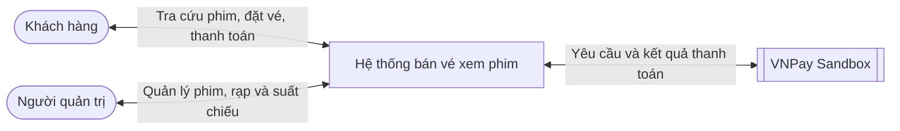
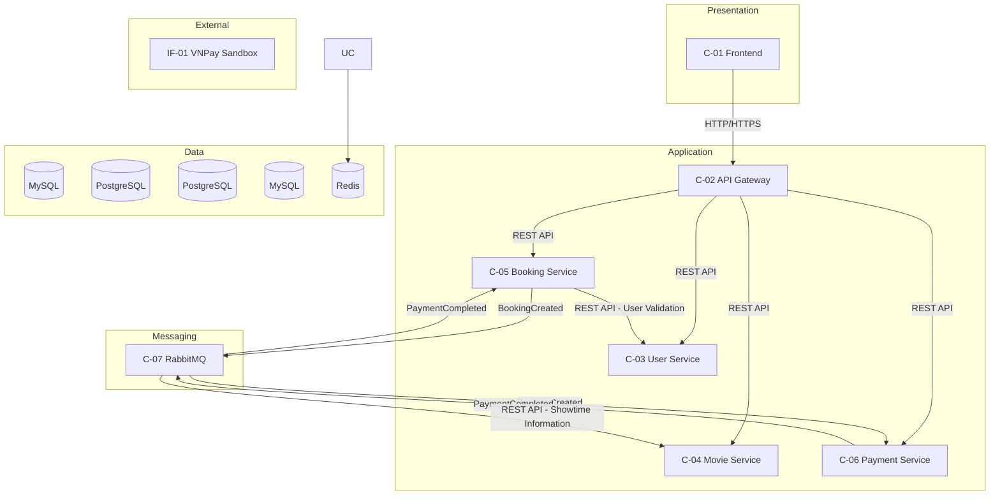
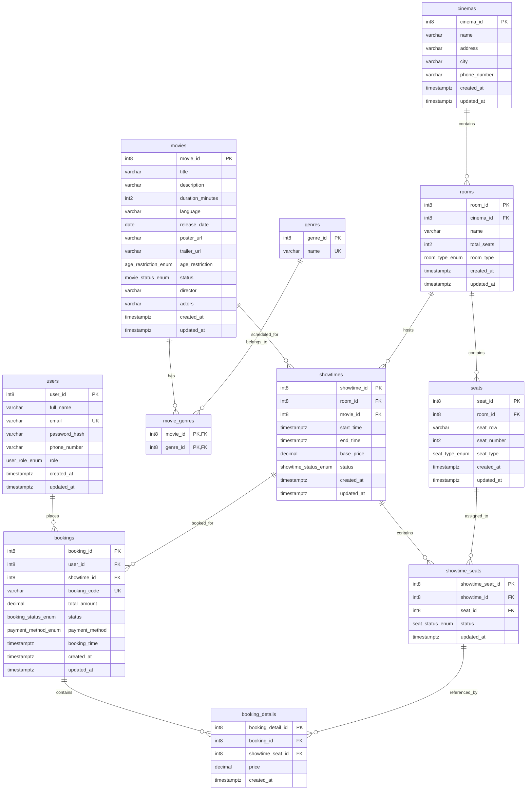
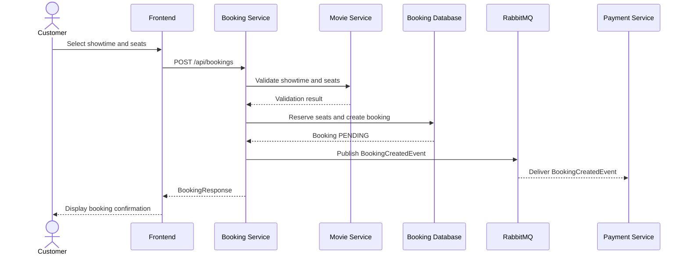

## Thông tin tài liệu

| Mục                 | Nội dung                                                                                              |
|---------------------|-------------------------------------------------------------------------------------------------------|
| Tên hệ thống        | `Hệ thống bán vé xem phim`                                                                            |
| Phiên bản tài liệu  | `0.1`                                                                                                 |
| Trạng thái          | Draft                                                                                                 |
| Phiên bản phát hành | `1.0`                                                                                                 |
| Ngày lập            | `28-09-2026`                                                                                          |
| Người thực hiện     | `Hoàng Thanh Diệu - Nhóm trưởng`   `Lường Thị Linh Đan`   `Lê Quang Hiếu`   `Đào Gia Huy` |
| Người phê duyệt     | `Hoàng Quang Huy - Giảng viên`                                                                        |
| Phân loại           | Nội bộ                                                                                                |

## Lịch sử chỉnh sửa

| Phiên bản | Ngày chỉnh sửa | Người thực hiện  | Phạm vi | Nội dung thay đổi |
|-----------|----------------|------------------|---------|-------------------|
| 0.1       | 28-09-2026     | Hoàng Thanh Diệu | Toàn bộ | Khởi tạo tài liệu |
|           |                |                  |         |                   |

---

# 1. Giới thiệu

## 1.1 Mục đích và phạm vi

> Tài liệu này mô tả thiết kế hệ thống đặt vé xem phim trực tuyến (Movie Ticket Booking System) theo kiến trúc
> Microservices, phiên bản phát hành 1.0.
> Hệ thống cho phép người dùng quản lý tài khoản cá nhân, tra cứu phim, xem lịch chiếu, lựa chọn ghế, đặt vé và thực
> hiện thanh toán.
> Tài liệu tập trung vào kiến trúc hệ thống, các dịch vụ độc lập, cơ sở dữ liệu, giao tiếp giữa các dịch vụ và các quy
> trình nghiệp vụ chính.

## 1.2 Đối tượng đọc tài liệu

| Đối tượng đọc                | Các mục cần đọc    |
|------------------------------|--------------------|
| Quản lý dự án                | 1, 2, 3            |
| Lập trình viên               | 4, 5, 6            |
| Người quản trị cơ sở dữ liệu | 5                  |
| Kỹ sư hạ tầng                | 4.4, 7             |
| Kỹ sư bảo mật                | 3.2, 7.2, 7.3      |
| Kiểm thử viên                | 6, 7.1, Appendix A |

## 1.3 Tài liệu tham khảo

| Mã     | Tên tài liệu                     | Phiên bản | Link                                             |
|--------|----------------------------------|-----------|--------------------------------------------------|
| REF-01 | Tài liệu đặc tả yêu cầu phần mềm | 1.0       | [SRS](docs/SoftwareRequirementsSpecification.md) |
| REF-02 | Tài liệu thiết kế cơ sở dữ liệu  | 1.0       |                                                  |
| REF-03 | Tài liệu đặc tả API              | 1.0       |                                                  |

---

# 2. Tổng quan hệ thống

## 2.1 Bối cảnh

- Hệ thống bán vé xem phim được xây dựng nhằm hỗ trợ người dùng tra cứu thông tin phim, lịch chiếu, lựa chọn ghế và đặt
  vé trực tuyến.
- Hệ thống áp dụng kiến trúc Microservices, phân chia các chức năng nghiệp vụ thành những dịch vụ độc lập, giúp thuận
  tiện trong quá trình phát triển, bảo trì và mở rộng.
- Dự án được thực hiện trong khuôn khổ môn học Phát triển phần mềm hướng dịch vụ, tập trung vào thiết kế, xây dựng và
  tích hợp các dịch vụ thông qua REST API và cơ chế giao tiếp bất đồng bộ bằng RabbitMQ.

## 2.2 Chức năng hệ thống

**Các chức năng của hệ thống:**

1. `Quản lý người dùng`
2. `Quản lý phim`
3. `Quản lý rạp chiếu`
4. `Quản lý suất chiếu`
5. `Đặt vé xem phim`
6. `Thanh toán trực tuyến`
7. `Quản lý lịch sử đặt vé`

**Các chức năng không có trong hệ thống:**

1. `Quản lý nhân sự và hoạt động vận hành rạp chiếu`
2. `Chương trình khách hàng thân thiết và tích điểm`

## 2.3 Sơ đồ ngữ cảnh

---

# 3. Các quyết định thiết kế

## 3.1 Giả định và các thành phần phụ thuộc

| ID    | Loại      | Mô tả                                                                                    | Ảnh hưởng nếu không được đáp ứng                                     | Đơn vị phụ trách                 |
|-------|-----------|------------------------------------------------------------------------------------------|----------------------------------------------------------------------|----------------------------------|
| AS-01 | Giả định  | Lưu lượng truy cập cao điểm không vượt quá 100 requests/second.                          | Cần đánh giá lại năng lực xử lý và khả năng mở rộng của các Service. | Toàn hệ thống                    |
| AS-02 | Giả định  | Số lượng người dùng đồng thời không vượt quá 200.                                        | Có thể phát sinh độ trễ khi truy vấn suất chiếu và đặt vé.           | Booking Service, Movie Service   |
| AS-03 | Giả định  | Mỗi ghế chỉ được xác nhận cho một đơn đặt vé trong cùng suất chiếu.                      | Có nguy cơ xảy ra Double Booking, gây mất nhất quán dữ liệu.         | Booking Service                  |
| DP-01 | Phụ thuộc | Các Microservices yêu cầu kết nối đến MySQL, PostgreSQL để truy xuất và lưu trữ dữ liệu. | Các thao tác phụ thuộc cơ sở dữ liệu không thể thực hiện.            | Các service liên quan            |
| DP-02 | Phụ thuộc | RabbitMQ cung cấp cơ chế trao đổi thông điệp giữa Booking Service và Payment Service     | Quá trình xử lý thanh toán bất đồng bộ bị gián đoạn.                 | Booking Service, Payment Service |
| DP-03 | Phụ thuộc | VNPay Sandbox cung cấp API phục vụ thử nghiệm thanh toán trực tuyến.                     | Không thể tạo hoặc xác nhận giao dịch thanh toán thông qua VNPay.    | Payment Service                  |

## 3.2 Các ràng buộc

| Lĩnh vực             | Ràng buộc                                                        | Ảnh hưởng đến thiết kế |
|----------------------|------------------------------------------------------------------|------------------------|
| Công nghệ            | `Backend Java 21, PostgreSQL và MySQL`                           |                        |
| Giao tiếp            | `Sử dụng REST API và RabbitMQ.`                                  |                        |
| Bảo mật              | `Toàn bộ lưu lượng truyền thông sử dụng TLS 1.3.`                |                        |
| Pháp lý              | `Dữ liệu cá nhân phải được lưu trữ trong lãnh thổ Việt Nam.`     |                        |
| Ngân sách            | `Sử dụng tối đa 6 máy ảo (Virtual Machines).`                    |                        |
| Thời gian            | `Thời gian phát triển giới hạn trong phạm vi học phần.`          |                        |
| Khả năng tương thích | `Các API phiên bản cũ phải tiếp tục hoạt động đến hết năm 2027.` |                        |

## 3.3 Mục tiêu chất lượng

| Thuộc tính                         | Mục tiêu                                   | Các phương pháp đo lường                                   |
|------------------------------------|--------------------------------------------|------------------------------------------------------------|
| Thời gian phản hồi (p95)           | Dưới 500 ms đối với 95% yêu cầu API nội bộ | Kiểm thử bằng Apache JMeter hoặc k6.                       |
| Thông lượng                        | 100 requests/second                        | Load Testing bằng Apache JMeter hoặc k6.                   |
| Người dùng đồng thời               | 2000                                       | Mô phỏng Virtual Users bằng công cụ kiểm thử tải           |
| Tính sẵn sàng                      | 99.9% trong thời gian kiểm thử có giám sát | Theo dõi trạng thái hoạt động thông qua Health Check.      |
| Mục tiêu điểm khôi phục (RPO)      | 15 phút                                    | Kiểm tra dữ liệu sau khi khôi phục từ bản sao lưu          |
| Mục tiêu thời gian khôi phục (RTO) | 1 giờ                                      | Đo thời gian khôi phục Service và cơ sở dữ liệu sau sự cố. |
| Thời gian lưu trữ dữ liệu          | 5 năm                                      | Kiểm tra dữ liệu lưu trữ trong PostgreSQL và MySQL.        |

**Giải thích:** RPO (Recovery Point Objective): Khoảng thời gian mất dữ liệu tối đa có thể chấp nhận khi xảy ra sự cố.

## 3.4 Biên bản quyết định

| ID      | Quyết định                                                                           | Trạng thái | Ngày       |
|---------|--------------------------------------------------------------------------------------|------------|------------|
| ADR-001 | `Sử dụng kiến trúc Microservices thay cho Monolithic Architecture`                   | Chấp nhận  | 28-09-2026 |
| ADR-002 | `Sử dụng Spring Boot với Java 21 để phát triển các Backend Service`                  | Chấp nhận  | 28-09-2026 |
| ADR-003 | `Sử dụng PostgreSQL và MySQL để lưu trữ dữ liệu quan hệ`                             | Chấp nhận  | 28-09-2026 |
| ADR-004 | `Sử dụng RabbitMQ để giao tiếp bất đồng bộ giữa Booking Service và Payment Service`  | Chấp nhận  | 28-09-2026 |
| ADR-005 | `Tích hợp VNPay Sandbox để thử nghiệm thanh toán trực tuyến thay cho Momo và VietQR` | Chấp nhận  | 10-10-2026 |

### ADR-001: Sử dụng kiến trúc Microservices

- **Trạng thái:** Chấp nhận
- **Vấn đề:** Cần lựa chọn kiến trúc phù hợp để phân tách và quản lý các nghiệp vụ của hệ thống.
- **Phương án:** Monolithic Architecture hoặc Microservices Architecture
- **Quyết định:** Sử dụng Microservices Architecture.
- **Lý do:** Cho phép phân chia hệ thống thành các Service độc lập theo nghiệp vụ, hỗ trợ phát triển, triển khai và mở
  rộng riêng biệt.
- **Hệ quả:** Tăng tính độc lập giữa các Service nhưng phát sinh độ phức tạp trong giao tiếp và quản lý dữ liệu phân
  tán.

### ADR-002: Sử dụng Spring Boot với Java 21

- **Trạng thái:** Chấp nhận.
- **Vấn đề:** Cần lựa chọn công nghệ Backend để xây dựng và tích hợp các Microservices.
- **Phương án:** Spring Boot (Java) hoặc NestJS (TypeScript).
- **Quyết định:** Sử dụng Spring Boot với Java 21.
- **Lý do:** Hỗ trợ phát triển REST API, Dependency Injection, Spring Data JPA và tích hợp Message Broker.
- **Hệ quả:** Thống nhất công nghệ Backend nhưng yêu cầu quản lý cấu hình và tài nguyên cho từng Service.

### ADR-003: Sử dụng PostgreSQL và MySQL

- **Trạng thái:** Chấp nhận.
- **Vấn đề:** Cần lựa chọn hệ quản trị cơ sở dữ liệu đáp ứng yêu cầu lưu trữ và tính toàn vẹn của dữ liệu nghiệp vụ.
- **Phương án:** PostgreSQL, MySQL hoặc MongoDB.
- **Quyết định:** Sử dụng PostgreSQL và MySQL.
- **Lý do:** Cả hai hệ quản trị đều hỗ trợ mô hình dữ liệu quan hệ, giao dịch ACID và các ràng buộc toàn vẹn.
- **Hệ quả:** Đáp ứng yêu cầu lưu trữ dữ liệu có cấu trúc nhưng làm tăng công việc quản lý cấu hình, kết nối và Database
  Migration.

### ADR-004: Sử dụng RabbitMQ để giao tiếp bất đồng bộ

- **Trạng thái:** Chấp nhận.
- **Vấn đề:** Các Service cần trao đổi sự kiện nghiệp vụ mà không phụ thuộc hoàn toàn vào giao tiếp đồng bộ.
- **Phương án:** REST API đồng bộ hoặc Event-Driven Communication thông qua RabbitMQ.
- **Quyết định:** Sử dụng RabbitMQ làm Message Broker.
- **Lý do:** Hỗ trợ trao đổi thông điệp bất đồng bộ và giảm phụ thuộc trực tiếp giữa Producer và Consumer.
- **Hệ quả:** Hỗ trợ xử lý sự kiện giữa các Service nhưng cần quản lý Message Acknowledgement, Retry và Idempotency.

### ADR-005: Tích hợp VNPay Sandbox

- **Trạng thái:** Chấp nhận.
- **Vấn đề:** Cần lựa chọn cổng thanh toán phục vụ kiểm thử quy trình thanh toán vé xem phim.
- **Phương án:** MoMo Sandbox, VietQR hoặc VNPay Sandbox.
- **Quyết định:** Sử dụng VNPay Sandbox.
- **Lý do:** VNPay Sandbox cung cấp môi trường thử nghiệm giao dịch và hỗ trợ tích hợp thanh toán thông qua API.
- **Hệ quả:** Payment Service phụ thuộc vào VNPay API và cần xử lý chữ ký bảo mật, Payment Callback/IPN và xác minh
  trạng thái giao dịch.

---

# 4. Kiến trúc hệ thống

## 4.1 Các thành phần

| ID   | Thành phần      | Trách nhiệm                                                                                        | Phụ thuộc              |
|------|-----------------|----------------------------------------------------------------------------------------------------|------------------------|
| C-01 | Frontend        | Cung cấp giao diện tương tác với người dùng.                                                       | C-02                   |
| C-02 | API Gateway     | Tiếp nhận, định tuyến các HTTP Request từ Frontend đến các Backend Service tương ứng.              | C-03, C-04, C-05, C-06 |
| C-03 | User Service    | Quản lý thông tin người dùng và tài khoản.                                                         | MySQL                  |
| C-04 | Movie Service   | Quản lý thông tin phim, rạp chiếu, phòng chiếu, ghế và suất chiếu.                                 | PostgreSQL             |
| C-05 | Booking Service | Xử lý yêu cầu đặt vé, quản lý trạng thái đặt vé và phát hành sự kiện đặt vé                        | C-04, C-07, PostgreSQL |
| C-06 | Payment Service | Quản lý giao dịch thanh toán, tích hợp VNPay Sandbox và phát hành sự kiện kết quả thanh toán.      | C-07, MySQL, IF-01     |
| C-07 | RabbitMQ        | Cung cấp Message Broker để trao đổi thông điệp bất đồng bộ giữa Booking Service và Payment Service | -                      |

**Hệ thống bên ngoài:**

| ID    | Hệ thống      | Vai trò                                              |
|-------|---------------|------------------------------------------------------|
| IF-01 | VNPay Sandbox | Cung cấp API thanh toán trong môi trường thử nghiệm. |

**Lý do phân chia hệ thống:**
`Do tham khảo từ nhiều nguồn khác nhau`

## 4.2 Sơ đồ kiến trúc hệ thống

## 4.3 Công nghệ sử dụng

| Hạng mục           | Công nghệ     | Phiên bản | Giấy phép  | Lý do lựa chọn                                                             |
|--------------------|---------------|-----------|------------|----------------------------------------------------------------------------|
| Ngôn ngữ lập trình | Java          | 21        |            | Hỗ trợ lập trình hướng đối tượng và có độ bảo mật cao                      |
| Ngôn ngữ lập trình | TypeScript    |           | Apache 2.0 | Phát triển Frontend, hỗ trợ kiểm tra kiểu dữ liệu tĩnh.                    |
| Framework          | Spring Boot   | 4.1.1     | Apache 2.0 | Xây dựng REST API, quản lý Dependency Injection.                           |
| Framework          | ReactJS       |           |            | Phát triển giao diện Web, hỗ trợ React và App Router.                      |
| Cơ sở dữ liệu      | PostgreSQL    |           |            | Lưu trữ dữ liệu quan hệ, hỗ trợ giao dịch ACID và ràng buộc toàn vẹn.      |
| Cơ sở dữ liệu      | MySQL         |           | GPLv2      | Lưu trữ dữ liệu giao dịch thanh toán của Payment Service.                  |
| Bộ nhớ đệm         | -             | -         | -          | -                                                                          |
| Message broker     | RabbitMQ      |           | MPL 2.0    | Hỗ trợ giao tiếp bất đồng bộ giữa các Microservices                        |
| Hệ điều hành       | Unbuntu Linux | 24.04 LTS |            | Cung cấp môi trường phát triển và chạy các Service.                        |
| Hệ điều hành       | Window        | 11        |            | Cung cấp môi trường phát triển, kiểm thử và sử dụng các công cụ lập trình. |

## 4.4 Hạ tầng và tài nguyên

| Thành phần              | Môi trường | Số lượng Instances   | CPU | Memory | Disk |
|-------------------------|------------|----------------------|-----|--------|------|
| C-01 Frontend (Next.js) | DEV/TEST   | 1                    | 1   | 1      | 5    |
| C-02 API Gateway        | DEV/TEST   | 1                    | 1   | 1      | 5    |
| C-03 User Service       | DEV/TEST   | 1                    | 1   | 1      | 5    |
| C-04 Movie Service      | DEV/TEST   | 1                    | 1   | 2      | 10   |
| C-05 Booking Service    | DEV/TEST   | 1                    | 1   | 2      | 10   |
| C-06 Payment Service    | DEV/TEST   | 1                    | 1   | 2      | 10   |
| C-07 RabbitMQ           | DEV/TEST   | 1                    | 1   | 1      | 5    |
| PostgreSQL              | DEV/TEST   | 1                    | 2   | 2      | 20   |
| MySQL                   | DEV/TEST   | 1                    | 2   | 2      | 20   |
| C-01 Frontend (Next.js) | PROD       | 2                    | 1   | 2      | 10   |
| C-02 API Gateway        | PROD       | 2                    | 1   | 2      | 10   |
| C-03 User Service       | PROD       | 2                    | 2   | 2      | 10   |
| C-04 Movie Service      | PROD       | 2                    | 2   | 4      | 20   |
| C-05 Booking Service    | PROD       | 2                    | 2   | 4      | 20   |
| C-06 Payment Service    | PROD       | 2                    | 2   | 4      | 20   |
| C-07 RabbitMQ           | PROD       | 1                    | 2   | 4      | 20   |
| PostgreSQL              | PROD       | 1 Primary, 1 Replica | 2   | 4      | 50   |
| MySQL                   | PROD       | 1 Primary, 1 Replica | 2   | 4      | 50   |

**Các kết nối mạng:**

| Nguồn                | Đích                 | Cổng | Giao thức        | Mã hóa       |
|----------------------|----------------------|------|------------------|--------------|
| Internet             | C-01 Frontend        | 443  | HTTPS            | TLS 1.3      |
| C-01 Frontend        | C-02 API Gateway     | 443  | HTTPS            | TLS 1.3      |
| C-02 API Gateway     | C-03 User Service    | 8081 | HTTP             | Không mã hóa |
| C-02 API Gateway     | C-04 Movie Service   | 8082 | HTTP             | Không mã hóa |
| C-02 API Gateway     | C-05 Booking Service | 8083 | HTTP             | Không mã hóa |
| C-02 API Gateway     | C-06 Payment Service | 8084 | HTTP             | Không mã hóa |
| C-05 Booking Service | C-04 Movie Service   | 8082 | HTTP             | Không mã hóa |
| C-05 Booking Service | C-07 RabbitMQ        | 5672 | AMQP             | Không mã hóa |
| C-06 Payment Service | C-07 RabbitMQ        | 5672 | AMQP             | Không mã hóa |
| C-03 User Service    | MySQL                | 3306 | TCP (MySQl)      | TLS          |
| C-04 Movie Service   | PostgreSQL           | 5432 | TCP (PostgreSQL) | TLS          |
| C-05 Booking Service | PostgreSQL           | 5432 | TCP (PostgreSQL) | TLS          |
| C-06 Payment Service | MySQL                | 3306 | TCP (MySQL)      | TLS          |
| C-06 Payment Service | IF-01 VNPay Sandbox  | 443  | HTTPS            | TLS          |

## 4.5 Chi tiết các thành phần

**What to write:** Complete one table for each component in section 4.1. Keep it short. The source code gives the
remainder of the detail.

### C-01: Frontend (Next.js)

| Thuộc tính    | Nội dung                                                                                                                                                        |
|---------------|-----------------------------------------------------------------------------------------------------------------------------------------------------------------|
| **Loại**      | user interface                                                                                                                                                  |
| **Ngôn ngữ**  | TypeScript, React/Next.js                                                                                                                                       |
| **Mục đích**  | Cung cấp giao diện tra cứu phim, chọn suất chiếu, đặt vé và thanh toán.                                                                                         |
| **Giao diện** | Trang danh sách/chi tiết phim, lịch chiếu, chọn ghế, đặt vé, thanh toán, lịch sử đặt vé; gọi REST API qua C-02.                                                 |
| **Phụ thuộc** | C-02 API Gateway; trình duyệt Web.                                                                                                                              |
| **Ràng buộc** | Trước thao tác đặt vé: người dùng cung cấp suất chiếu và ghế hợp lệ;  Sau thao tác: hiển thị kết quả trả về, không tự xác nhận thanh toán.                  |
| **Xử lý lỗi** | Hiển thị thông báo khi API timeout/không khả dụng;  Cho phép tải lại hoặc thử lại thao tác đọc;  Tránh tự động gửi lại yêu cầu đặt vé có thể gây trùng. |
| **Yêu cầu**   | REQ-UI, REQ-MOVIE, REQ-BOOKING, REQ-PAYMENT (mã tạm).                                                                                                           |

### C-02: API Gateway

| Thuộc tính    | Nội dung                                                                                                                       |
|---------------|--------------------------------------------------------------------------------------------------------------------------------|
| **Loại**      | Service / Infrastructure Component                                                                                             |
| **Ngôn ngữ**  | Java (Spring Cloud Gateway, nếu được lựa chọn)                                                                                 |
| **Mục đích**  | Cung cấp điểm truy cập thống nhất và định tuyến yêu cầu đến các Backend Service.                                               |
| **Giao diện** | Các tuyến HTTP(S) chuyển tiếp đến User, Movie, Booking và Payment Service.                                                     |
| **Phụ thuộc** | C-03, C-04, C-05, C-06.                                                                                                        |
| **Ràng buộc** | Trước định tuyến: có đường dẫn và phương thức hợp lệ;  Sau định tuyến: chuyển tiếp phản hồi; không lưu dữ liệu nghiệp vụ.  |
| **Xử lý lỗi** | Trả về mã lỗi phù hợp như 502/503/504;  Không tự động retry yêu cầu tạo đặt vé/thanh toán nếu không có cơ chế idempotency. |
| **Yêu cầu**   | REQ-GATEWAY (mã tạm).                                                                                                          |

### C-03: User Service

| Thuộc tính    | Nội dung                                                                                                     |
|---------------|--------------------------------------------------------------------------------------------------------------|
| **Loại**      | Service                                                                                                      |
| **Ngôn ngữ**  | Java 21, Spring Boot                                                                                         |
| **Mục đích**  | Quản lý thông tin người dùng và cung cấp dữ liệu tài khoản.                                                  |
| **Giao diện** | REST API quản lý/truy vấn người dùng.                                                                        |
| **Phụ thuộc** | Cơ sở dữ liệu người dùng (MySQL).                                                                            |
| **Ràng buộc** | Trước truy vấn: ID hợp lệ và quyền truy cập phù hợp; Sau truy vấn: trả về người dùng tương ứng hoặc 404. |
| **Xử lý lỗi** | Trả 503 khi cơ sở dữ liệu không khả dụng; Không trả dữ liệu người dùng chưa xác minh.                    |
| **Yêu cầu**   | REQ-USER (mã tạm).                                                                                           |

### C-04: Movie Service

| Thuộc tính    | Nội dung                                                                                                                                                                                     |
|---------------|----------------------------------------------------------------------------------------------------------------------------------------------------------------------------------------------|
| **Loại**      | Service                                                                                                                                                                                      |
| **Ngôn ngữ**  | Java 21, Spring Boot                                                                                                                                                                         |
| **Mục đích**  | Quản lý phim, rạp, phòng chiếu, ghế và suất chiếu.                                                                                                                                           |
| **Giao diện** | REST API truy vấn/quản lý phim, rạp, suất chiếu và ghế;  Endpoint cụ thể theo các Controller hiện có.                                                                                    |
| **Phụ thuộc** | Cơ sở dữ liệu phim và lịch chiếu (PostgreSQL).                                                                                                                                               |
| **Ràng buộc** | Trước thêm/cập nhật: dữ liệu phim, phòng chiếu và thời gian hợp lệ; Sau thao tác: lưu thay đổi nhất quán. Thông tin ghế khả dụng cần được kiểm tra với cơ chế giữ/đặt ghế có thẩm quyền. |
| **Xử lý lỗi** | Trả lỗi phù hợp khi dữ liệu không tồn tại hoặc cơ sở dữ liệu không khả dụng;  Không trả kết quả xác nhận ghế nếu không kiểm tra được trạng thái có thẩm quyền.                           |
| **Yêu cầu**   | REQ-MOVIE, REQ-CINEMA, REQ-SHOWTIME, REQ-SEAT (mã tạm).                                                                                                                                      |

### C-05: Booking Service

| Thuộc tính    | Nội dung                                                                                                                                                                                                                                                                                        |
|---------------|-------------------------------------------------------------------------------------------------------------------------------------------------------------------------------------------------------------------------------------------------------------------------------------------------|
| **Loại**      | Service                                                                                                                                                                                                                                                                                         |
| **Ngôn ngữ**  | Java 21, Spring Boot                                                                                                                                                                                                                                                                            |
| **Mục đích**  | Tạo và quản lý đặt vé, phát hành sự kiện `BookingCreated` và xử lý kết quả thanh toán.                                                                                                                                                                                                          |
| **Giao diện** | REST API đặt vé/tra cứu đặt vé; RabbitMQ Producer `BookingCreated`; Consumer `PaymentCompleted`.                                                                                                                                                                                                |
| **Phụ thuộc** | C-04 Movie Service; C-07 RabbitMQ; cơ sở dữ liệu Booking (PostgreSQL).                                                                                                                                                                                                                          |
| **Ràng buộc** | Trước tạo đặt vé: người dùng, suất chiếu, ghế và giá vé hợp lệ; ghế chưa bị giữ/đặt bởi giao dịch khác.  Sau tạo: lưu trạng thái đặt vé và phát hành sự kiện. Chuyển sang `PAID` sau khi xác minh kết quả thanh toán thành công; cần kiểm soát đặt trùng ghế và xử lý thông điệp trùng lặp. |
| **Xử lý lỗi** | Nếu Movie Service/DB không khả dụng: không xác nhận đặt vé;  Nếu RabbitMQ lỗi: lưu trạng thái chờ và phát lại sự kiện theo cơ chế Outbox/Retry khi được triển khai; sự kiện thanh toán không hợp lệ không được chuyển trạng thái sang `PAID`.                                               |
| **Yêu cầu**   | REQ-BOOKING, REQ-SEAT, REQ-PAYMENT (mã tạm).                                                                                                                                                                                                                                                    |

### C-06: Payment Service

| Thuộc tính    | Nội dung                                                                                                                                                                                                                                                         |
|---------------|------------------------------------------------------------------------------------------------------------------------------------------------------------------------------------------------------------------------------------------------------------------|
| **Loại**      | Service                                                                                                                                                                                                                                                          |
| **Ngôn ngữ**  | Java 21, Spring Boot                                                                                                                                                                                                                                             |
| **Mục đích**  | Quản lý giao dịch thanh toán, tích hợp VNPay Sandbox và thông báo kết quả thanh toán cho Booking Service.                                                                                                                                                        |
| **Giao diện** | REST API tra cứu/khởi tạo thanh toán;  VNPay Payment URL/Callback/IPN; RabbitMQ Consumer `BookingCreated` và Producer `PaymentCompleted`.                                                                                                                    |
| **Phụ thuộc** | C-07 RabbitMQ; MySQL; IF-01 VNPay Sandbox.                                                                                                                                                                                                                       |
| **Ràng buộc** | Trước tạo giao dịch: Booking hợp lệ, số tiền và mã giao dịch được xác định;  Sau xử lý: trạng thái thanh toán được lưu. Chỉ ghi nhận thành công sau khi xác thực chữ ký và đối soát thông tin giao dịch; yêu cầu idempotency đối với callback/IPN trùng lặp. |
| **Xử lý lỗi** | Nếu VNPay timeout: giữ trạng thái chưa xác định/chờ xác minh, không mặc định thất bại hoặc thành công;  Nếu DB/RabbitMQ lỗi: ghi nhận và thử xử lý lại an toàn theo cơ chế được triển khai.                                                                  |
| **Yêu cầu**   | REQ-PAYMENT (mã tạm).                                                                                                                                                                                                                                            |

### C-07: RabbitMQ

| Thuộc tính    | Nội dung                                                                                                                                                                                                            |
|---------------|---------------------------------------------------------------------------------------------------------------------------------------------------------------------------------------------------------------------|
| **Loại**      | Message Broker / Infrastructure Component                                                                                                                                                                           |
| **Ngôn ngữ**  | RabbitMQ Server (Erlang/OTP); ứng dụng Java sử dụng Spring AMQP                                                                                                                                                     |
| **Mục đích**  | Định tuyến và truyền thông điệp bất đồng bộ giữa Booking Service và Payment Service.                                                                                                                                |
| **Giao diện** | AMQP; Direct Exchange `booking.exchange`;  Routing Key `booking.created`, `payment.completed`;  Queue `booking.created.queue`, `payment.completed.queue`.                                                   |
| **Phụ thuộc** | Hạ tầng mạng, lưu trữ và cấu hình RabbitMQ; C-05/C-06 là các bên kết nối.                                                                                                                                           |
| **Ràng buộc** | Producer phải sử dụng Exchange/Routing Key phù hợp; Consumer cần xử lý thông điệp có thể bị gửi lại. Durable Queue không tự bảo đảm thông điệp bền vững nếu thiếu cấu hình phù hợp cho message và xác nhận publish. |
| **Xử lý lỗi** | Khi broker mất kết nối: Producer/Consumer không thể trao đổi sự kiện; cần cơ chế reconnect, publisher confirms, retry và dead-letter queue nếu được triển khai.                                                     |
| **Yêu cầu**   | REQ-MESSAGING, REQ-BOOKING, REQ-PAYMENT (mã tạm).                                                                                                                                                                   |

---

# 5. Data Design

## 5.1 Data Model

## 5.2 Các bảng và chỉ mục

| Bảng              | Mục đích                                           | Khóa chính             | Chỉ mục                                          | Truy vấn được hỗ trợ                                                    |
|-------------------|----------------------------------------------------|------------------------|--------------------------------------------------|-------------------------------------------------------------------------|
| `users`           | Lưu trữ thông tin tài khoản người dùng.            | `user_id`              | `uq_users_email` (UNIQUE)                        | Tìm kiếm tài khoản theo email khi đăng nhập.                            |
| `movies`          | Lưu trữ thông tin phim.                            | `movie_id`             | `idx_movies_status`                              | Lọc danh sách phim theo trạng thái phát hành.                           |
| `genres`          | Lưu trữ danh sách thể loại phim.                   | `genre_id`             | `uq_genres_name` (UNIQUE)                        | Tìm kiếm thể loại theo tên và ngăn trùng lặp.                           |
| `movie_genres`    | Quản lý quan hệ nhiều-nhiều giữa phim và thể loại. | `(movie_id, genre_id)` | `idx_movie_genres_genre_id`                      | Tìm danh sách phim thuộc một thể loại.                                  |
| `cinemas`         | Lưu trữ thông tin rạp chiếu phim.                  | `cinema_id`            | `idx_cinemas_city`                               | Tìm kiếm các rạp chiếu theo thành phố.                                  |
| `rooms`           | Lưu trữ thông tin phòng chiếu thuộc rạp.           | `room_id`              | `idx_rooms_cinema_id`                            | Lấy danh sách phòng chiếu của một rạp.                                  |
| `seats`           | Lưu trữ thông tin ghế trong phòng chiếu.           | `seat_id`              | `idx_seats_room_id`                              | Lấy danh sách ghế thuộc một phòng chiếu.                                |
| `showtimes`       | Lưu trữ thông tin các suất chiếu phim.             | `showtime_id`          | `idx_showtimes_movie_id_start_time`              | Tìm các suất chiếu của một phim trong khoảng thời gian.                 |
| `showtimes`       | Lưu trữ thông tin các suất chiếu phim.             | `showtime_id`          | `idx_showtimes_room_id_start_time`               | Tìm lịch chiếu của một phòng trong khoảng thời gian.                    |
| `showtime_seats`  | Quản lý trạng thái ghế theo từng suất chiếu.       | `showtime_seat_id`     | `uq_showtime_seats_showtime_id_seat_id` (UNIQUE) | Xác định trạng thái một ghế trong suất chiếu và ngăn tạo bản ghi trùng. |
| `bookings`        | Lưu trữ thông tin đặt vé của người dùng.           | `booking_id`           | `uq_bookings_booking_code` (UNIQUE)              | Tra cứu đơn đặt vé theo mã đặt vé.                                      |
| `bookings`        | Lưu trữ thông tin đặt vé của người dùng.           | `booking_id`           | `idx_bookings_user_id_created_at`                | Tra cứu lịch sử đặt vé của người dùng theo thời gian.                   |
| `booking_details` | Lưu trữ thông tin từng ghế được đặt trong đơn.     | `booking_detail_id`    | `idx_booking_details_booking_id`                 | Lấy danh sách ghế và giá vé thuộc một đơn đặt vé.                       |

## 5.3 Dung lượng dữ liệu

| Bảng              | Số bản ghi ban đầu | Tăng trưởng mỗi tháng | Kích thước bản ghi | Dung lượng sau 3 năm |
|-------------------|-------------------:|----------------------:|-------------------:|---------------------:|
| `users`           |                100 |                   200 |          500 bytes |              3,65 MB |
| `movies`          |                 50 |                    20 |        1.000 bytes |              0,77 MB |
| `genres`          |                 10 |                     1 |          100 bytes |             0,005 MB |
| `movie_genres`    |                100 |                    40 |           32 bytes |              0,05 MB |
| `cinemas`         |                  5 |                     1 |          500 bytes |              0,02 MB |
| `rooms`           |                 20 |                     4 |          200 bytes |              0,03 MB |
| `seats`           |              2.000 |                   400 |          100 bytes |              1,64 MB |
| `showtimes`       |                100 |                 1.000 |          200 bytes |              7,22 MB |
| `showtime_seats`  |             10.000 |               100.000 |          100 bytes |               361 MB |
| `bookings`        |                  0 |                 5.000 |          300 bytes |                54 MB |
| `booking_details` |                  0 |                10.000 |          100 bytes |                36 MB |
| **Tổng cộng**     |         **12.385** |           **116.666** |                  — |       **≈ 464,4 MB** |

## 5.4 Các tệp lưu trữ ngoài cơ sở dữ liệu

| Tệp hoặc Bucket       | Mục đích                                                       | Định dạng        | Thành phần ghi               | Thành phần đọc            | Thời gian lưu trữ       |
|-----------------------|----------------------------------------------------------------|------------------|------------------------------|---------------------------|-------------------------|
| `s3://exports/`       | Lưu trữ báo cáo doanh thu, đặt vé và giao dịch thanh toán.     | CSV / PDF        | Backend Service / Report Job | Người quản trị            | 90 ngày                 |
| `uploads/movies/`     | Lưu trữ hình ảnh poster và nội dung truyền thông của phim.     | JPG / PNG / WebP | Movie Service                | Frontend, Movie Service   | Đến khi hình ảnh bị xóa |
| `uploads/cinemas/`    | Lưu trữ hình ảnh rạp chiếu và phòng chiếu.                     | JPG / PNG / WebP | Movie Service                | Frontend, Movie Service   | Đến khi hình ảnh bị xóa |
| Application logs      | Ghi nhận hoạt động hệ thống, thông tin lỗi và hỗ trợ giám sát. | LOG / JSON       | Tất cả Backend Service       | Developer, Người quản trị | 30 ngày                 |
| `backups/postgresql/` | Lưu trữ bản sao lưu dữ liệu người dùng, phim và đặt vé.        | SQL / DUMP       | Database Backup Job          | Người quản trị            | 30 ngày                 |
| `backups/mysql/`      | Lưu trữ bản sao lưu dữ liệu giao dịch thanh toán.              | SQL / DUMP       | Database Backup Job          | Người quản trị            | 30 ngày                 |

## 5.5. Sao lưu và khôi phục dữ liệu

| Hạng mục                           | Đặc tả                                                        |
|------------------------------------|---------------------------------------------------------------|
| Loại                               | Sao lưu toàn bộ hằng tuần và sao lưu gia tăng hằng ngày.      |
| Lịch                               | 02:00 ICT (UTC+7), thực hiện tự động.                         |
| Phạm vi                            | PostgreSQL, MySQL và các tệp dữ liệu quan trọng của hệ thống. |
| Vị trí                             | Amazon S3, sử dụng bucket riêng cho dữ liệu sao lưu.          |
| Thời gian lưu trữ                  | 30 ngày.                                                      |
| Mã hóa                             | AES-256 cho dữ liệu lưu trữ; TLS cho dữ liệu truyền tải.      |
| Mục tiêu điểm khôi phục (RPO)      | ≤ 24 giờ.                                                     |
| Mục tiêu thời gian khôi phục (RTO) | ≤ 2 giờ.                                                      |
| Kiểm thử khôi phục                 | Mỗi quý một lần, ghi nhận kết quả kiểm thử.                   |
| Thành phần chịu trách nhiệm        | Database Backup Job và Người quản trị.                        |

---

# 6. Giao diện hệ thống

## 6.1 Nhóm người dùng

| Nhóm người dùng | Nhiệm vụ                                                                                      | Tổng số người dùng | Người dùng đồng thời | Bên ngoài |
|-----------------|-----------------------------------------------------------------------------------------------|-------------------:|---------------------:|-----------|
| Khách hàng      | Tìm kiếm phim, xem lịch chiếu, chọn ghế, đặt vé, thanh toán trực tuyến và xem lịch sử đặt vé. |             10.000 |                  500 | Yes       |
| Người quản trị  | Quản lý phim, rạp chiếu, phòng chiếu, suất chiếu, người dùng và theo dõi hoạt động hệ thống.  |                  5 |                    2 | No        |

## 6.2 Màn hình và dữ liệu đầu vào

| Screen ID | Tên màn hình                                   | Nhóm người dùng            | Mục đích                                                            |
|-----------|------------------------------------------------|----------------------------|---------------------------------------------------------------------|
| SCR-01    | Trang chủ (Home Page)                          | khách hàng                 | Hiển thị danh sách phim đang chiếu, sắp chiếu và thông tin nổi bật. |
| SCR-02    | Đăng ký (Register)                             | khách hàng                 | Tạo tài khoản người dùng mới.                                       |
| SCR-03    | Đăng nhập (Login)                              | khách hàng, Người quản trị | Xác thực người dùng và truy cập hệ thống.                           |
| SCR-04    | Danh sách phim (Movie List)                    | khách hàng                 | Tìm kiếm, lọc và xem danh sách phim.                                |
| SCR-05    | Chi tiết phim (Movie Details)                  | khách hàng                 | Hiển thị thông tin phim, mô tả, thời lượng và lịch chiếu.           |
| SCR-06    | Lựa chọn suất chiếu (Showtime Selection)       | khách hàng                 | Chọn rạp chiếu, ngày chiếu và suất chiếu phù hợp.                   |
| SCR-07    | Lựa chọn ghế (Seat Selection)                  | khách hàng                 | Hiển thị sơ đồ ghế và cho phép lựa chọn ghế còn trống.              |
| SCR-08    | Xác nhận đặt vé (Booking Confirmation)         | khách hàng                 | Kiểm tra thông tin vé, ghế và tổng số tiền trước khi thanh toán.    |
| SCR-09    | Thanh toán (Payment)                           | khách hàng                 | Khởi tạo giao dịch thanh toán trực tuyến qua VNPay Sandbox.         |
| SCR-10    | Kết quả thanh toán (Payment Result)            | khách hàng                 | Hiển thị trạng thái thanh toán và kết quả đặt vé.                   |
| SCR-11    | Lịch sử đặt vé (Booking History)               | khách hàng                 | Xem danh sách các vé đã đặt và trạng thái đặt vé.                   |
| SCR-12    | Thông tin cá nhân (User Profile)               | khách hàng                 | Xem và cập nhật thông tin tài khoản.                                |
| SCR-13    | Trang quản trị (Admin Dashboard)               | Người quản trị             | Hiển thị tổng quan hoạt động của hệ thống.                          |
| SCR-14    | Quản lý phim (Movie Management)                | Người quản trị             | Thêm, sửa, xóa và cập nhật thông tin phim.                          |
| SCR-15    | Quản lý rạp và phòng chiếu (Cinema Management) | Người quản trị             | Quản lý thông tin rạp chiếu, phòng chiếu và ghế.                    |
| SCR-16    | Quản lý suất chiếu (Showtime Management)       | Người quản trị             | Tạo, cập nhật và quản lý lịch chiếu phim.                           |
| SCR-17    | Quản lý đặt vé (Booking Management)            | Người quản trị             | Theo dõi và quản lý các đơn đặt vé.                                 |
| SCR-18    | Quản lý người dùng (User Management)           | Người quản trị             | Xem và quản lý thông tin tài khoản người dùng.                      |

**Quy tắc xác thực cho SCR-01: Trang chủ (Home Page)**

| Trường    | Kiểu dữ liệu | Độ dài | Cần thiết | Giá trị hợp lệ                          | Thông báo nếu lỗi                           |
|-----------|--------------|--------|-----------|-----------------------------------------|---------------------------------------------|
| `keyword` | varchar      | 100    | Không     | Chuỗi từ 1–100 ký tự nếu được cung cấp. | "Tên phim không được vượt quá 100 ký tự."   |
| `genreId` | bigint       | —      | Không     | ID thể loại tồn tại trong hệ thống.     | "Thể loại phim không hợp lệ."               |
| `status`  | enum         | —      | Không     | Trạng thái phim được hệ thống hỗ trợ.   | "Trạng thái phim không hợp lệ."             |
| `page`    | integer      | —      | Không     | Số nguyên ≥ 0, mặc định 0.              | "Số trang không hợp lệ."                    |
| `size`    | integer      | —      | Không     | Từ 1 đến 100, mặc định 10.              | "Số lượng phim hiển thị phải từ 1 đến 100." |

**Quy tắc xác thực cho SCR-02: Register**

| Trường        | Kiểu dữ liệu | Độ dài | Cần thiết | Giá trị hợp lệ                      | Error message                              |
|---------------|--------------|--------|-----------|-------------------------------------|--------------------------------------------|
| `fullName`    | varchar      | 100    | Yes       | Chuỗi không rỗng, tối đa 100 ký tự. | "Họ tên không hợp lệ."                     |
| `email`       | varchar      | 255    | Yes       | Email hợp lệ, chưa được đăng ký.    | "Email không hợp lệ hoặc đã được sử dụng." |
| `password`    | varchar      | 255    | Yes       | Từ 8–72 ký tự.                      | "Mật khẩu phải có từ 8 đến 72 ký tự."      |
| `phoneNumber` | varchar      | 15     | No        | Số điện thoại hợp lệ.               | "Số điện thoại không hợp lệ."              |

**Quy tắc xác thực cho SCR-03: Login**

| Trường     | Kiểu dữ liệu | Độ dài | Cần thiết | Giá trị hợp lệ    | Error message             |
|------------|--------------|--------|-----------|-------------------|---------------------------|
| `email`    | varchar      | 255    | Yes       | Email hợp lệ.     | "Email không hợp lệ."     |
| `password` | varchar      | 255    | Yes       | Chuỗi không rỗng. | "Vui lòng nhập mật khẩu." |

**Quy tắc xác thực cho SCR-06: Showtime Selection**

| Trường       | Kiểu dữ liệu | Độ dài | Cần thiết | Giá trị hợp lệ                  | Error message                |
|--------------|--------------|--------|-----------|---------------------------------|------------------------------|
| `movieId`    | bigint       | —      | Yes       | ID phim tồn tại.                | "Phim không tồn tại."        |
| `cinemaId`   | bigint       | —      | Yes       | ID rạp chiếu hợp lệ.            | "Rạp chiếu không hợp lệ."    |
| `showDate`   | date         | —      | Yes       | Ngày chiếu hợp lệ.              | "Ngày chiếu không hợp lệ."   |
| `showtimeId` | bigint       | —      | Yes       | Suất chiếu còn cho phép đặt vé. | "Suất chiếu không khả dụng." |

**Quy tắc xác thực cho SCR-07: Seat Selection**

| Trường       | Kiểu dữ liệu | Độ dài | Cần thiết | Giá trị hợp lệ                          | Error message                 |
|--------------|--------------|--------|-----------|-----------------------------------------|-------------------------------|
| `showtimeId` | bigint       | —      | Yes       | ID suất chiếu hợp lệ.                   | "Suất chiếu không hợp lệ."    |
| `seatIds`    | array        | 10     | Yes       | Từ 1–10 ID ghế hợp lệ, không trùng lặp. | "Danh sách ghế không hợp lệ." |

**Quy tắc xác thực cho SCR-09: Payment**

| Trường          | Kiểu dữ liệu | Độ dài | Cần thiết | Giá trị hợp lệ                                            | Error message                          |
|-----------------|--------------|--------|-----------|-----------------------------------------------------------|----------------------------------------|
| `bookingId`     | bigint       | —      | Yes       | Đơn đặt vé hợp lệ, thuộc người dùng được phép thanh toán. | "Đơn đặt vé không hợp lệ."             |
| `paymentMethod` | enum         | —      | Yes       | `VNPAY` hoặc phương thức được hỗ trợ.                     | "Phương thức thanh toán không hợp lệ." |

**Cảnh báo:**

Frontend và Backend phải áp dụng các quy tắc kiểm tra dữ liệu tương ứng.
Tuy nhiên, Frontend Validation không đủ để bảo đảm an toàn vì người dùng có thể gửi HTTP Request trực tiếp đến API.

Mọi dữ liệu đầu vào phải được kiểm tra lại tại Backend. Đặc biệt, trạng thái ghế, quyền truy cập đơn đặt vé và số tiền
thanh toán phải được xác minh từ dữ liệu phía Server.

**Khả năng tiếp cận:**

Giao diện hệ thống phải đáp ứng WCAG 2.1 Level AA, bao gồm:

- Hỗ trợ thao tác bằng bàn phím trên tất cả màn hình.
- Cung cấp nhãn cho các trường nhập liệu.
- Hiển thị thông báo lỗi rõ ràng khi dữ liệu không hợp lệ.
- Đảm bảo độ tương phản màu sắc theo yêu cầu WCAG.
- Hiển thị trạng thái Focus khi điều hướng bằng bàn phím.
- Hỗ trợ công nghệ đọc màn hình (Screen Reader).

## 6.3 Dữ liệu đầu ra

| ID     | Tên đầu ra                   | Loại          | Nội dung                                                                 | Người sử dụng                    | Tần suất                                  | Giới hạn truy cập                         |
|--------|------------------------------|---------------|--------------------------------------------------------------------------|----------------------------------|-------------------------------------------|-------------------------------------------|
| OUT-01 | Danh sách phim               | Web UI / JSON | Tên phim, thể loại, thời lượng, poster, trạng thái phát hành.            | Khách hàng                       | Khi truy cập hoặc tìm kiếm.               | Public                                    |
| OUT-02 | Thông tin suất chiếu         | Web UI / JSON | Phim, rạp chiếu, phòng chiếu, ngày giờ chiếu, giá vé.                    | Khách hàng                       | Khi tìm kiếm suất chiếu.                  | Public                                    |
| OUT-03 | Sơ đồ ghế                    | Web UI / JSON | Danh sách ghế, loại ghế và trạng thái khả dụng.                          | Khách hàng                       | Khi chọn ghế hoặc cập nhật trạng thái.    | Người dùng được phép đặt vé               |
| OUT-04 | Xác nhận đặt vé              | Web UI / JSON | Mã đặt vé, phim, suất chiếu, ghế, tổng tiền và trạng thái đặt vé.        | Khách hàng                       | Sau khi tạo đơn đặt vé.                   | Chủ sở hữu đơn đặt vé                     |
| OUT-05 | Kết quả thanh toán           | Web UI / JSON | Mã giao dịch, mã đặt vé, số tiền, trạng thái thanh toán.                 | Khách hàng                       | Sau khi nhận kết quả thanh toán từ VNPay. | Chủ sở hữu giao dịch                      |
| OUT-06 | Lịch sử đặt vé               | Web UI / JSON | Danh sách đơn đặt vé, thời gian đặt, tổng tiền và trạng thái.            | Khách hàng                       | Khi người dùng truy cập.                  | Chủ sở hữu tài khoản                      |
| OUT-07 | Thông tin tài khoản          | Web UI / JSON | Họ tên, email, số điện thoại và thông tin tài khoản được phép hiển thị.  | Khách hàng                       | Khi truy cập trang cá nhân.               | Chủ sở hữu tài khoản                      |
| OUT-08 | Báo cáo doanh thu hằng ngày  | CSV           | Ngày báo cáo, số vé bán, số đơn thanh toán thành công và tổng doanh thu. | Người quản trị                   | Hằng ngày lúc 07:00 ICT.                  | Chỉ quyền quản trị                        |
| OUT-09 | Báo cáo đặt vé               | CSV / PDF     | Mã đặt vé, phim, suất chiếu, số lượng vé, tổng tiền và trạng thái.       | Người quản trị                   | Khi được yêu cầu.                         | Chỉ quyền quản trị                        |
| OUT-10 | Báo cáo giao dịch thanh toán | CSV           | Mã giao dịch, mã đặt vé, số tiền, phương thức và trạng thái thanh toán.  | Người quản trị                   | Khi được yêu cầu.                         | Chỉ quyền quản trị                        |
| OUT-11 | Thống kê quản trị            | Web UI / JSON | Tổng số người dùng, phim, đơn đặt vé và doanh thu.                       | Người quản trị                   | Khi truy cập Dashboard.                   | Chỉ quyền quản trị                        |
| OUT-12 | Nhật ký ứng dụng             | LOG / JSON    | Thời gian, Service, mức độ log, thông điệp và thông tin lỗi.             | Người phát triển, Người quản trị | Khi phát sinh sự kiện.                    | Người có quyền truy cập hệ thống vận hành |

## 6.4 API nội bộ

| ID     | Phương thức và đường dẫn        | Mục đích                            | Yêu cầu      | Phản hồi                     | Mã trạng thái lỗi | Xác thực     |
|--------|---------------------------------|-------------------------------------|--------------|------------------------------|-------------------|--------------|
| API-01 | `GET /api/users/{id}`           | Lấy thông tin người dùng.           | `userId`     | `UserResponse`               | 401, 403, 404     | Bearer Token |
| API-02 | `GET /api/showtimes/{id}`       | Lấy thông tin chi tiết suất chiếu.  | `showtimeId` | `ShowtimeResponse`           | 404               | Public       |
| API-03 | `GET /api/showtimes/{id}/seats` | Lấy trạng thái ghế theo suất chiếu. | `showtimeId` | `List<ShowtimeSeatResponse>` | 404               | Public       |
| API-04 | `GET /api/bookings/{id}`        | Tra cứu thông tin đặt vé.           | `bookingId`  | `BookingResponse`            | 401, 403, 404     | Bearer Token |

**Mã lỗi:**

| Code      | HTTP Status | Ý nghĩa                                               | Hướng xử lý (Correction)                 |
|-----------|-------------|-------------------------------------------------------|------------------------------------------|
| `USR-001` | 404         | Không tìm thấy người dùng.                            | Kiểm tra ID người dùng.                  |
| `USR-002` | 409         | Email đã được đăng ký.                                | Sử dụng email khác.                      |
| `USR-003` | 401         | Email hoặc mật khẩu không chính xác.                  | Kiểm tra thông tin đăng nhập.            |
| `USR-004` | 403         | Người dùng không có quyền truy cập tài nguyên.        | Sử dụng tài khoản có quyền phù hợp.      |
| `MOV-001` | 404         | Không tìm thấy phim.                                  | Kiểm tra ID phim.                        |
| `MOV-002` | 400         | Thông tin phim không hợp lệ.                          | Kiểm tra và cập nhật dữ liệu phim.       |
| `CIN-001` | 404         | Không tìm thấy rạp chiếu phim.                        | Kiểm tra ID rạp chiếu.                   |
| `ROM-001` | 404         | Không tìm thấy phòng chiếu.                           | Kiểm tra ID phòng chiếu.                 |
| `SHW-001` | 404         | Không tìm thấy suất chiếu.                            | Chọn suất chiếu hợp lệ.                  |
| `SHW-002` | 409         | Suất chiếu không còn khả dụng để đặt vé.              | Chọn suất chiếu khác.                    |
| `SEA-001` | 404         | Không tìm thấy ghế.                                   | Kiểm tra ID ghế.                         |
| `SEA-002` | 409         | Ghế đã được đặt hoặc đang được giữ.                   | Chọn ghế khác.                           |
| `SEA-003` | 400         | Danh sách ghế được chọn không hợp lệ.                 | Chọn lại danh sách ghế.                  |
| `BKG-001` | 404         | Không tìm thấy đơn đặt vé.                            | Kiểm tra mã đặt vé.                      |
| `BKG-002` | 409         | Đơn đặt vé đã tồn tại hoặc xung đột trạng thái.       | Kiểm tra trạng thái đơn đặt vé.          |
| `BKG-003` | 400         | Đơn đặt vé không hợp lệ.                              | Kiểm tra thông tin đặt vé.               |
| `BKG-004` | 409         | Đơn đặt vé đã hết thời gian thanh toán.               | Tạo đơn đặt vé mới.                      |
| `PAY-001` | 404         | Không tìm thấy giao dịch thanh toán.                  | Kiểm tra mã giao dịch.                   |
| `PAY-002` | 400         | Số tiền thanh toán không hợp lệ.                      | Kiểm tra lại thông tin thanh toán.       |
| `PAY-003` | 409         | Đơn đặt vé đã được thanh toán.                        | Kiểm tra trạng thái thanh toán hiện tại. |
| `PAY-004` | 502         | Không thể kết nối hoặc nhận phản hồi hợp lệ từ VNPay. | Thử lại sau hoặc liên hệ hỗ trợ.         |
| `PAY-005` | 400         | Chữ ký xác thực VNPay không hợp lệ.                   | Kiểm tra chữ ký và cấu hình tích hợp.    |
| `SYS-001` | 400         | Dữ liệu yêu cầu không hợp lệ.                         | Kiểm tra các trường dữ liệu đầu vào.     |
| `SYS-002` | 401         | Chưa xác thực hoặc Access Token không hợp lệ.         | Đăng nhập lại.                           |
| `SYS-003` | 403         | Không có quyền thực hiện thao tác.                    | Kiểm tra quyền truy cập.                 |
| `SYS-004` | 500         | Lỗi xử lý nội bộ hệ thống.                            | Thử lại sau hoặc liên hệ hỗ trợ.         |
| `SYS-005` | 503         | Dịch vụ tạm thời không khả dụng.                      | Thử lại sau.                             |

## 6.5 Hệ thống bên ngoài

| ID    | Hệ thống                        | Đơn vị cung cấp | Hướng giao tiếp | Loại giao tiếp      | Tần suất                 |
|-------|---------------------------------|-----------------|-----------------|---------------------|--------------------------|
| IF-01 | VNPay Payment Gateway (Sandbox) | VNPay           | Both            | HTTPS / Payment API | Mỗi giao dịch thanh toán |

### Chi tiết IF-01: VNPay Payment Gateway

| Hạng mục       | Đặc tả                                                                                     |
|----------------|--------------------------------------------------------------------------------------------|
| Data format    | URL query parameters và dữ liệu phản hồi theo giao thức VNPay.                             |
| Authentication | `vnp_TmnCode` và chữ ký HMAC-SHA512 sử dụng Secret Key.                                    |
| Timeout        | 5 giây đối với HTTP Request chủ động gửi đến VNPay.                                        |
| Retry          | Tối đa 3 lần với khoảng chờ 1, 2 và 4 giây, chỉ áp dụng cho thao tác an toàn khi thử lại.  |
| Idempotency    | Sử dụng `vnp_TxnRef` duy nhất và kiểm tra trạng thái giao dịch trước khi cập nhật dữ liệu. |
| Error report   | Ghi lỗi vào Application Logs và thông báo cho người quản trị khi cần thiết.                |
| Reconciliation | Đối chiếu giao dịch hằng ngày lúc 23:00 ICT.                                               |
| Contact        | VNPay Developer Support – theo kênh hỗ trợ chính thức.                                     |

**Lưu ý:** Hệ thống bên ngoài có thể gặp sự cố hoặc tạm thời không khả dụng. Payment Service phải xử lý Timeout, lỗi kết
nối và phản hồi không hợp lệ mà không làm mất tính nhất quán của dữ liệu đặt vé và thanh toán.
Hành vi xử lý lỗi của từng thành phần được mô tả tại mục 4.5.

---

# 7. Vận hành và bảo mật

## 7.1 Kịch bản vận hành

### SC-01: Khách hàng đăng ký tài khoản

- **Actor:** Khách hàng
- **Tiền điều kiện:** Khách hàng chưa có tài khoản trong hệ thống..
- **Bắt đầu khi:** Khách hàng nhấn nút "Đăng ký".
- **Dung lượng:** 100 yêu cầu/giờ; giờ cao điểm 300 yêu cầu/giờ.

| Bước | Actor        | Hành động                           | Hệ thống trả về                             |
|------|--------------|-------------------------------------|---------------------------------------------|
| 1    | Khách hàng   | Nhập thông tin đăng ký.             | Frontend kiểm tra định dạng dữ liệu.        |
| 2    | Khách hàng   | Gửi yêu cầu đăng ký.                | User Service tiếp nhận và kiểm tra dữ liệu. |
| 3    | User Service | Kiểm tra email đã tồn tại hay chưa. | Cơ sở dữ liệu trả về kết quả kiểm tra.      |
| 4    | User Service | Mã hóa mật khẩu và tạo tài khoản.   | Cở sở dữ liệu lưu thông tin người dùng.     |
| 5    | Hệ thống     | Trả kết quả đăng ký.                | Hiển thị thông báo đăng ký thành công.      |

**Luồng thay thế:**

| ID | Điều kiện                     | Kết quả                                        |
|----|-------------------------------|------------------------------------------------|
| E1 | Email đã được đăng ký.        | Trả HTTP `409 Conflict` với mã lỗi `USR-002`.  |
| E2 | Dữ liệu đăng ký không hợp lệ. | Trả HTTP `400 Bad Request`.                    |
| E3 | Cơ sở dữ liệu không khả dụng. | Trả HTTP `503 Service Unavailable` và ghi log. |

### SC-02: Khách hàng đăng nhập (khách hàng Login)

- **Actor:** Khách hàng
- **Precondition:** Khách hàng đã có tài khoản.
- **Trigger:** Khách hàng nhấn nút "Đăng nhập".
- **Volume:** 300 yêu cầu/giờ; giờ cao điểm 1.000 yêu cầu/giờ.

| Bước | Actor        | Hành động                       | Phản hồi                                   |
|------|--------------|---------------------------------|--------------------------------------------|
| 1    | khách hàng   | Nhập email và mật khẩu.         | Frontend kiểm tra dữ liệu đầu vào.         |
| 2    | khách hàng   | Gửi yêu cầu đăng nhập.          | User Service tiếp nhận thông tin xác thực. |
| 3    | User Service | Kiểm tra tài khoản và mật khẩu. | Database trả về thông tin người dùng.      |
| 4    | User Service | Tạo Access Token.               | Trả kết quả xác thực cho Frontend.         |
| 5    | Hệ thống     | Hoàn tất đăng nhập.             | Chuyển người dùng đến trang phù hợp.       |

**Luồng thay thế:**

| ID | Condition                            | Kết quả                             |
|----|--------------------------------------|-------------------------------------|
| E1 | Email hoặc mật khẩu không chính xác. | Trả HTTP `401 Unauthorized`.        |
| E2 | Dữ liệu đăng nhập không hợp lệ.      | Trả HTTP `400 Bad Request`.         |
| E3 | Dịch vụ xác thực không khả dụng.     | Trả HTTP `503 Service Unavailable`. |

### SC-03: Khách hàng tìm kiếm phim và suất chiếu (Movie and Showtime Search)

- **Actor:** Khách hàng
- **Precondition:** Movie Service đang hoạt động và có dữ liệu phim, suất chiếu.
- **Trigger:** Khách hàng tìm kiếm phim hoặc chọn ngày chiếu.
- **Volume:** 2.000 yêu cầu/giờ; giờ cao điểm 5.000 yêu cầu/giờ.

| Bước | Actor         | Hành động                  | Phản hồi                                     |
|------|---------------|----------------------------|----------------------------------------------|
| 1    | khách hàng    | Truy cập danh sách phim.   | Frontend gửi yêu cầu đến Movie Service.      |
| 2    | Movie Service | Truy vấn danh sách phim.   | Database trả về dữ liệu phim.                |
| 3    | khách hàng    | Chọn phim và ngày chiếu.   | Frontend gửi yêu cầu tìm kiếm suất chiếu.    |
| 4    | Movie Service | Lọc suất chiếu phù hợp.    | Trả danh sách rạp, phòng và thời gian chiếu. |
| 5    | Hệ thống      | Hiển thị kết quả tìm kiếm. | Khách hàng có thể chọn suất chiếu.           |

**Luồng thay thế:**

| ID | Condition                       | Kết quả                                       |
|----|---------------------------------|-----------------------------------------------|
| E1 | Không tìm thấy phim phù hợp.    | Hiển thị danh sách rỗng và thông báo phù hợp. |
| E2 | Không có suất chiếu trong ngày. | Yêu cầu khách hàng chọn ngày khác.            |
| E3 | Movie Service không khả dụng.   | Hiển thị thông báo lỗi và cho phép thử lại.   |

### SC-04: Khách hàng đặt vé xem phim (Movie Ticket Booking)

- **Actor:** khách hàng
- **Precondition:** Khách hàng đã đăng nhập, chọn suất chiếu hợp lệ và có ghế khả dụng.
- **Trigger:** Khách hàng nhấn nút "Xác nhận đặt vé".
- **Volume:** 300 giao dịch/giờ; giờ cao điểm 1.200 giao dịch/giờ.

| Bước | Actor           | Hành động                               | Phản hồi                                             |
|------|-----------------|-----------------------------------------|------------------------------------------------------|
| 1    | khách hàng      | Chọn suất chiếu và ghế.                 | Hệ thống hiển thị thông tin ghế và giá vé.           |
| 2    | khách hàng      | Gửi yêu cầu đặt vé.                     | Booking Service tiếp nhận yêu cầu.                   |
| 3    | Booking Service | Kiểm tra tính hợp lệ và trạng thái ghế. | Xác định các ghế có thể đặt.                         |
| 4    | Booking Service | Giữ ghế và tạo đơn đặt vé.              | Lưu Booking với trạng thái `PENDING`.                |
| 5    | Booking Service | Phát hành `BookingCreatedEvent`.        | RabbitMQ chuyển sự kiện đến Payment Service.         |
| 6    | Hệ thống        | Trả thông tin đơn đặt vé.               | Frontend hiển thị mã đặt vé và thông tin thanh toán. |

**Luồng thay thế:**

| ID | Condition                            | Kết quả                                                  |
|----|--------------------------------------|----------------------------------------------------------|
| E1 | Ghế đã được đặt bởi người dùng khác. | Trả HTTP `409 Conflict`, mã lỗi `SEA-002`.               |
| E2 | Suất chiếu không còn khả dụng.       | Trả HTTP `409 Conflict`, mã lỗi `SHW-002`.               |
| E3 | Dữ liệu đặt vé không hợp lệ.         | Trả HTTP `400 Bad Request`.                              |
| E4 | RabbitMQ tạm thời không khả dụng.    | Ghi nhận lỗi và áp dụng cơ chế phát lại sự kiện an toàn. |

### SC-05: Khách hàng thanh toán vé (Ticket Payment)

- **Actor:** khách hàng
- **Precondition:** Đơn đặt vé tồn tại, đang ở trạng thái `PENDING` và chưa hết thời hạn thanh toán.
- **Trigger:** Khách hàng nhấn nút "Thanh toán".
- **Volume:** 300 giao dịch/giờ; giờ cao điểm 1.200 giao dịch/giờ.

| Bước | Actor           | Hành động                          | Phản hồi                                          |
|------|-----------------|------------------------------------|---------------------------------------------------|
| 1    | khách hàng      | Chọn phương thức thanh toán VNPay. | Frontend gửi yêu cầu đến Payment Service.         |
| 2    | Payment Service | Kiểm tra đơn đặt vé và số tiền.    | Xác định giao dịch hợp lệ.                        |
| 3    | Payment Service | Tạo URL thanh toán VNPay.          | Trả URL thanh toán cho Frontend.                  |
| 4    | khách hàng      | Thực hiện thanh toán trên VNPay.   | VNPay xử lý giao dịch.                            |
| 5    | VNPay           | Gửi kết quả thanh toán qua IPN.    | Payment Service xác minh chữ ký và giao dịch.     |
| 6    | Payment Service | Cập nhật trạng thái thanh toán.    | Lưu giao dịch `SUCCESS` nếu thanh toán hợp lệ.    |
| 7    | Payment Service | Phát hành `PaymentCompletedEvent`. | RabbitMQ chuyển sự kiện đến Booking Service.      |
| 8    | Booking Service | Cập nhật trạng thái đơn đặt vé.    | Booking chuyển sang `CONFIRMED`.                  |
| 9    | Hệ thống        | Hiển thị kết quả thanh toán.       | Khách hàng nhận được thông tin đặt vé thành công. |

**Alternative flows:**

| ID | Condition                              | Kết quả                                                           |
|----|----------------------------------------|-------------------------------------------------------------------|
| E1 | Khách hàng hủy thanh toán.             | Ghi nhận kết quả hủy theo chính sách nghiệp vụ.                   |
| E2 | VNPay trả kết quả thanh toán thất bại. | Payment Service ghi nhận `FAILED` sau khi xác minh.               |
| E3 | Không nhận được phản hồi từ VNPay.     | Giữ trạng thái `PENDING` và kiểm tra lại giao dịch.               |
| E4 | Chữ ký VNPay không hợp lệ.             | Từ chối cập nhật trạng thái và ghi Security Log.                  |
| E5 | RabbitMQ không khả dụng.               | Lưu trạng thái thanh toán, bảo đảm sự kiện có thể được phát lại.  |
| E6 | Nhận IPN trùng lặp.                    | Xử lý Idempotency, không cập nhật hoặc phát sinh giao dịch trùng. |

**Sequence Diagram:**

~~~mermaid
sequenceDiagram
    actor C as Customer
    participant F as Frontend
    participant P as Payment Service
    participant V as VNPay Gateway
    participant D as Payment Database
    participant R as RabbitMQ
    participant B as Booking Service
    C ->> F: Click Pay
    F ->> P: Create VNPay payment
    P ->> D: Create payment (PENDING)
    P -->> F: Payment URL
    F -->> C: Redirect to VNPay
    C ->> V: Complete payment
    V ->> P: Payment IPN
    P ->> P: Verify signature and transaction
    P ->> D: Update payment (SUCCESS)
    P ->> R: Publish PaymentCompletedEvent
    R -->> B: Deliver PaymentCompletedEvent
    B ->> B: Update booking (CONFIRMED)
    V -->> C: Redirect to return URL
    C ->> F: View payment result
~~~

---

### SC-06: Khách hàng xem lịch sử đặt vé (Booking History)

- **Actor:** khách hàng
- **Precondition:** Khách hàng đã đăng nhập.
- **Trigger:** Khách hàng truy cập mục "Lịch sử đặt vé".
- **Volume:** 500 yêu cầu/giờ; giờ cao điểm 1.500 yêu cầu/giờ.

| Bước | Actor           | Hành động                      | Phản hồi                                        |
|------|-----------------|--------------------------------|-------------------------------------------------|
| 1    | khách hàng      | Truy cập lịch sử đặt vé.       | Frontend gửi yêu cầu đến Booking Service.       |
| 2    | Booking Service | Xác thực người dùng.           | Xác định User ID từ thông tin xác thực.         |
| 3    | Booking Service | Truy vấn danh sách đơn đặt vé. | Database trả về các đơn thuộc người dùng.       |
| 4    | Hệ thống        | Hiển thị lịch sử đặt vé.       | Khách hàng xem trạng thái và chi tiết từng đơn. |

**Alternative flows:**

| ID | Condition                                   | Kết quả                      |
|----|---------------------------------------------|------------------------------|
| E1 | Người dùng chưa đăng nhập.                  | Trả HTTP `401 Unauthorized`. |
| E2 | Không có lịch sử đặt vé.                    | Hiển thị danh sách rỗng.     |
| E3 | Người dùng truy cập đơn của tài khoản khác. | Trả HTTP `403 Forbidden`.    |

**Sequence Diagram:**

~~~mermaid
sequenceDiagram
    actor C as Customer
    participant F as Frontend
    participant B as Booking Service
    participant D as Booking Database
    C ->> F: Open Booking History
    F ->> B: GET /api/bookings/my
    B ->> B: Validate authentication
    B ->> D: Find bookings by userId
    D -->> B: List of bookings
    B -->> F: BookingResponse[]
    F -->> C: Display booking history
~~~

---

### SC-07: Người quản trị quản lý phim và suất chiếu (Movie and Showtime Management)

- **Actor:** Người quản trị
- **Precondition:** Người quản trị đã đăng nhập và có quyền quản lý phim, suất chiếu.
- **Trigger:** Người quản trị thực hiện thêm, sửa hoặc xóa dữ liệu.
- **Volume:** 50 yêu cầu/giờ; giờ cao điểm 150 yêu cầu/giờ.

| Bước | Actor          | Hành động                          | Phản hồi                                         |
|------|----------------|------------------------------------|--------------------------------------------------|
| 1    | Người quản trị | Truy cập trang quản lý phim.       | Hệ thống hiển thị danh sách phim.                |
| 2    | Người quản trị | Thêm hoặc cập nhật thông tin phim. | Movie Service kiểm tra dữ liệu đầu vào.          |
| 3    | Movie Service  | Lưu thông tin phim.                | Database cập nhật dữ liệu.                       |
| 4    | Người quản trị | Tạo hoặc cập nhật suất chiếu.      | Movie Service kiểm tra phòng chiếu và thời gian. |
| 5    | Movie Service  | Lưu thông tin suất chiếu.          | Database cập nhật dữ liệu suất chiếu.            |
| 6    | Hệ thống       | Trả kết quả thao tác.              | Hiển thị thông báo thành công.                   |

**Alternative flows:**

| ID | Condition                                         | Kết quả                     |
|----|---------------------------------------------------|-----------------------------|
| E1 | Người quản trị không có quyền thực hiện thao tác. | Trả HTTP `403 Forbidden`.   |
| E2 | Dữ liệu phim không hợp lệ.                        | Trả HTTP `400 Bad Request`. |
| E3 | Suất chiếu trùng lịch sử dụng phòng.              | Trả HTTP `409 Conflict`.    |
| E4 | Phim hoặc suất chiếu không tồn tại.               | Trả HTTP `404 Not Found`.   |

**Sequence Diagram:**

~~~mermaid
sequenceDiagram
    actor A as Người quản trị
    participant F as Frontend
    participant M as Movie Service
    participant D as Movie Database
    A ->> F: Open Movie Management
    F ->> M: GET /api/movies
    M ->> D: Query movies
    D -->> M: Movie list
    M -->> F: MovieResponse[]
    F -->> A: Display movie list
    A ->> F: Create or update movie
    F ->> M: POST /api/movies
    M ->> M: Validate input and authorization
    M ->> D: Save movie
    D -->> M: Saved movie
    M -->> F: MovieResponse
    F -->> A: Display success message
    A ->> F: Create showtime
    F ->> M: POST /api/showtimes
    M ->> M: Validate room and schedule
    M ->> D: Save showtime
    D -->> M: Saved showtime
    M -->> F: ShowtimeResponse
    F -->> A: Display success message
~~~

---

### SC-08: Người quản trị xem báo cáo doanh thu (Revenue Reporting)

- **Actor:** Người quản trị
- **Precondition:** Người quản trị đã đăng nhập và có quyền xem báo cáo.
- **Trigger:** Người quản trị yêu cầu xuất báo cáo hoặc hệ thống kích hoạt tác vụ định kỳ.
- **Volume:** 20 yêu cầu/giờ; giờ cao điểm 50 yêu cầu/giờ.

| Bước | Actor          | Hành động                              | Phản hồi                                        |
|------|----------------|----------------------------------------|-------------------------------------------------|
| 1    | Người quản trị | Chọn khoảng thời gian báo cáo.         | Frontend gửi yêu cầu xuất báo cáo.              |
| 2    | Hệ thống       | Thu thập dữ liệu giao dịch thành công. | Payment Service cung cấp dữ liệu thanh toán.    |
| 3    | Hệ thống       | Tổng hợp số lượng vé và doanh thu.     | Tạo dữ liệu báo cáo.                            |
| 4    | Hệ thống       | Xuất báo cáo CSV.                      | Lưu tệp vào `s3://mtbs-storage/exports/`.       |
| 5    | Hệ thống       | Trả kết quả xuất báo cáo.              | Người quản trị tải báo cáo theo quyền được cấp. |

**Alternative flows:**

| ID | Condition                       | Kết quả                                     |
|----|---------------------------------|---------------------------------------------|
| E1 | Khoảng thời gian không hợp lệ.  | Trả HTTP `400 Bad Request`.                 |
| E2 | Không có dữ liệu giao dịch.     | Xuất báo cáo rỗng hoặc hiển thị thông báo.  |
| E3 | Payment Service không khả dụng. | Ghi log và thông báo không thể tạo báo cáo. |
| E4 | Amazon S3 không khả dụng.       | Ghi nhận lỗi và cho phép thử lại.           |

**Sequence Diagram:**

~~~mermaid
sequenceDiagram
    actor A as Người quản trị
    participant F as Frontend
    participant R as Reporting Component
    participant P as Payment Service
    participant D as Payment Database
    participant S as Amazon S3
    A ->> F: Select reporting period
    F ->> R: Request revenue report
    R ->> P: Request successful payments
    P ->> D: Query payment transactions
    D -->> P: Payment records
    P -->> R: Payment data
    R ->> R: Calculate revenue statistics
    R ->> R: Generate CSV report
    R ->> S: Upload CSV file
    S -->> R: Upload confirmation
    R -->> F: Report download reference
    F -->> A: Display report result
~~~

## 7.2 Kiểm soát truy cập

| Dữ liệu                   | Khách hàng       | Người quản trị               |
|---------------------------|------------------|------------------------------|
| Movie information         | Read             | Create, Read, Update, Delete |
| Cinema information        | Read             | Create, Read, Update, Delete |
| Room and seat information | Read             | Create, Read, Update, Delete |
| Showtime information      | Read             | Create, Read, Update, Delete |
| Own booking               | Create, Read     | Read                         |
| All bookings              | —                | Read                         |
| Seat reservation          | Create, Read own | Read                         |
| Own payment               | Create, Read     | Read                         |
| All payments              | —                | Read                         |
| Own user profile          | Read, Update     | Read                         |
| User accounts             | —                | Read, Update                 |
| Revenue reports           | —                | Read, Export                 |
| System configuration      | —                | Read, Update                 |
| Application logs          | —                | Read (Authorized only)       |

**Quy tắc:**

- Mỗi vai trò chỉ được cấp những quyền cần thiết để thực hiện chức năng của mình.
- Mọi yêu cầu truy cập phải được kiểm tra quyền tại Backend.
- Dữ liệu cá nhân nhạy cảm cần được bảo vệ bằng cơ chế mã hóa phù hợp.
- Thông tin nhạy cảm phải được loại bỏ hoặc che giấu trong Application Logs.

## 7.3 Nhật ký kiểm toán

Mỗi Audit Record bao gồm các trường sau:

| Trường                 | Ví dụ                              |
|------------------------|------------------------------------|
| User ID                | `10293`                            |
| Source IP              | `203.0.113.7`                      |
| Date and time (UTC)    | `2026-10-14T09:14:22Z`             |
| Service                | `booking-service`                  |
| Operation              | `UPDATE booking.status`            |
| Resource ID            | `booking_10025`                    |
| Data before the change | `PENDING`                          |
| Data after the change  | `CONFIRMED`                        |
| Result                 | `SUCCESS` hoặc `FAILURE`           |
| Trace ID               | `4bf92f3577b34da6a3ce929d0e0e4736` |

**Retention:** 5 năm kể từ thời điểm tạo Audit Record.

**Storage:** Lưu Audit Records trong kho lưu trữ riêng biệt, có cơ chế chống sửa đổi.

## 7.4 Giám sát và báo cáo

| Signal                         | Threshold                                               | Alert to            | Action                                                             |
|--------------------------------|---------------------------------------------------------|---------------------|--------------------------------------------------------------------|
| HTTP Error Rate (5xx)          | > 1% trong 5 phút                                       | Backend Developer   | Kiểm tra Application Logs và xác định Microservice gặp lỗi.        |
| API Response Time (p95)        | > 300 ms trong 10 phút                                  | Backend Developer   | Kiểm tra Database Queries, Connection Pool và tài nguyên hệ thống. |
| Service Availability           | Health Check thất bại trong 1 phút                      | Backend Developer   | Kiểm tra trạng thái Service và Application Logs.                   |
| CPU Usage                      | > 80% trong 10 phút                                     | Infrastructure Team | Kiểm tra tiến trình và điều chỉnh tài nguyên.                      |
| Memory Usage                   | > 85% trong 10 phút                                     | Infrastructure Team | Kiểm tra Memory Leak, JVM Heap và Garbage Collection.              |
| Disk Usage                     | > 80% dung lượng                                        | Infrastructure Team | Kiểm tra dung lượng lưu trữ và mở rộng khi cần.                    |
| Database Connection Pool       | > 90% trong 5 phút                                      | Backend Developer   | Kiểm tra Connection Leak và Slow Queries.                          |
| Database Availability          | Database không phản hồi trong 1 phút                    | Backend Developer   | Kiểm tra kết nối và trạng thái Database.                           |
| RabbitMQ Queue Backlog         | > 1.000 Messages trong 5 phút                           | Backend Developer   | Kiểm tra Consumer và Messages tồn đọng.                            |
| RabbitMQ Consumer Availability | Không có Consumer hoạt động trong 1 phút                | Backend Developer   | Kiểm tra kết nối và khởi động lại Consumer nếu cần.                |
| RabbitMQ Dead Letter Queue     | Có Message mới trong DLQ                                | Backend Developer   | Kiểm tra Message lỗi và thực hiện Replay an toàn.                  |
| Booking Failure Rate           | > 5% trong 5 phút                                       | Backend Developer   | Kiểm tra Booking Service và Database Transaction.                  |
| Seat Reservation Conflict Rate | > 10% trong 5 phút                                      | Backend Developer   | Kiểm tra cơ chế Concurrency Control.                               |
| Payment Failure Rate           | > 5% trong 10 phút                                      | Backend Developer   | Kiểm tra Payment Service và VNPay Response.                        |
| VNPay Response Time            | > 5 giây đối với yêu cầu đồng bộ                        | Backend Developer   | Kiểm tra kết nối và Timeout Policy.                                |
| Payment–Booking Inconsistency  | Payment SUCCESS nhưng Booking chưa CONFIRMED quá 5 phút | Backend Developer   | Kiểm tra RabbitMQ Events và thực hiện Reconciliation.              |
| Authentication Failure Rate    | > 20 lần/phút trên cùng tài khoản hoặc nguồn IP         | Backend Developer   | Kiểm tra Security Logs và áp dụng Rate Limiting.                   |
| Backup Failure                 | Một tác vụ Backup thất bại                              | Infrastructure Team | Kiểm tra Backup Logs và thực hiện lại tác vụ.                      |

## 7.5 Triển khai và khôi phục phiên bản

### Deployment Procedure

| Step | Action                   | Description                                                 | Expected Result                          |
|------|--------------------------|-------------------------------------------------------------|------------------------------------------|
| 1    | Build Application        | Build các Microservices và Frontend.                        | Build thành công.                        |
| 2    | Run Automated Tests      | Thực hiện Unit Test, Integration Test và API Test.          | Các bài kiểm thử bắt buộc thành công.    |
| 3    | Deploy to UAT            | Triển khai phiên bản mới lên môi trường UAT.                | Các Service hoạt động bình thường.       |
| 4    | Verify Integration       | Kiểm tra Database, RabbitMQ và VNPay Sandbox.               | Các kết nối hoạt động thành công.        |
| 5    | Test Booking Flow        | Kiểm thử chọn ghế, đặt vé và thanh toán.                    | Booking và Payment được xử lý chính xác. |
| 6    | Backup Database          | Sao lưu Database trước khi triển khai Production.           | Có bản Backup có thể khôi phục.          |
| 7    | Apply Database Migration | Thực hiện Migration tương thích với các phiên bản ứng dụng. | Database Schema được cập nhật.           |
| 8    | Deploy to Production     | Triển khai bằng Rolling Update nếu hạ tầng hỗ trợ.          | Phiên bản mới hoạt động.                 |
| 9    | Verify Health Checks     | Theo dõi Health Endpoint trong 10 phút.                     | Các Service duy trì trạng thái Healthy.  |
| 10   | Monitor System           | Theo dõi Error Rate, Response Time và tài nguyên hệ thống.  | Không phát hiện sự cố nghiêm trọng.      |
| 11   | Complete Deployment      | Xác nhận và ghi nhận phiên bản triển khai.                  | Deployment hoàn tất.                     |

### Rollback Procedure

| Step | Action                        | Description                                           | Expected Result                        |
|------|-------------------------------|-------------------------------------------------------|----------------------------------------|
| 1    | Detect Failure                | Phát hiện lỗi qua Monitoring hoặc Health Check.       | Xác định sự cố.                        |
| 2    | Stop Deployment               | Dừng triển khai phiên bản mới.                        | Ngăn tiếp tục phát hành phiên bản lỗi. |
| 3    | Assess Database Compatibility | Kiểm tra tính tương thích của Database Schema.        | Xác định phương án Rollback an toàn.   |
| 4    | Restore Previous Version      | Triển khai lại phiên bản ổn định trước đó.            | Service sử dụng phiên bản cũ.          |
| 5    | Handle Database Migration     | Chỉ chạy Down Migration khi an toàn và đã kiểm chứng. | Database duy trì tính nhất quán.       |
| 6    | Verify Service Health         | Kiểm tra Health Endpoint và kết nối giữa các Service. | Các Service hoạt động bình thường.     |
| 7    | Verify Booking and Payment    | Kiểm tra trạng thái giao dịch và RabbitMQ Events.     | Không phát sinh sai lệch dữ liệu.      |
| 8    | Record Incident               | Ghi nhận nguyên nhân và kết quả Rollback.             | Có thông tin phục vụ điều tra sự cố.   |

### Rollback Triggers

| Condition                  | Threshold                          | Action                                            |
|----------------------------|------------------------------------|---------------------------------------------------|
| HTTP Error Rate            | > 1% trong 5 phút                  | Điều tra và cân nhắc Rollback.                    |
| API Response Time (p95)    | > 300 ms trong 10 phút             | Kiểm tra hiệu năng và đánh giá Rollback.          |
| Service Health Check       | Thất bại liên tục trong 1 phút     | Dừng triển khai và đánh giá Rollback.             |
| Booking Failure Rate       | > 5% trong 5 phút                  | Kiểm tra Booking Service.                         |
| Payment Processing Failure | Lỗi nghiêm trọng do phiên bản mới  | Dừng triển khai và xử lý sự cố.                   |
| Data Inconsistency         | Booking và Payment không nhất quán | Bảo toàn dữ liệu và đánh giá Rollback.            |
| Database Migration Failure | Migration thất bại                 | Dừng triển khai và thực hiện phương án khôi phục. |

**Deployment Rules:**

- Triển khai lên môi trường UAT trước khi triển khai Production.
- Chỉ triển khai Production khi các bài kiểm thử bắt buộc thành công.
- Sao lưu Database trước các thay đổi Schema có rủi ro.
- Sử dụng Rolling Update nếu hạ tầng hỗ trợ nhiều Instance.
- Theo dõi Health Endpoint ít nhất 10 phút sau triển khai.
- Theo dõi các chỉ số Monitoring được định nghĩa tại mục 7.4.
- Dừng triển khai khi phát hiện lỗi nghiêm trọng.
- Chỉ thực hiện Rollback Database khi đã kiểm tra tính tương thích
  và khả năng khôi phục dữ liệu.
- Ghi nhận Deployment Version, thời gian và kết quả triển khai.

**CẢNH BÁO:**

Database Migration có thể không thể Rollback nếu thao tác đã
xóa cột, xóa bảng hoặc làm mất dữ liệu.

Chỉ xóa các thành phần Database không còn sử dụng trong một
phiên bản phát hành sau, khi ứng dụng đã hoạt động ổn định
mà không phụ thuộc vào chúng.

Đối với Booking Service và Payment Service, Rollback ứng dụng
không được tự ý đảo ngược các giao dịch đã thanh toán thành công.
---

# Phụ lục A — Ma trận truy vết yêu cầu

## A.1. Yêu cầu chức năng

| ID yêu cầu | Mô tả                                                         | Mục           | Thành phần        | Test Case | Trạng thái |
|------------|---------------------------------------------------------------|---------------|-------------------|-----------|------------|
| REQ-001    | Khách hàng có thể đăng ký tài khoản.                          | 6.2, 6.4, 7.1 | C-01, C-03        | TC-001    | Covered    |
| REQ-002    | Khách hàng có thể đăng nhập và xác thực tài khoản.            | 6.2, 6.4, 7.1 | C-01, C-03        | TC-002    | Covered    |
| REQ-003    | Khách hàng có thể xem và cập nhật thông tin cá nhân.          | 6.2, 6.4, 7.2 | C-01, C-03        | TC-003    | Covered    |
| REQ-004    | Khách hàng có thể xem danh sách phim.                         | 6.2, 6.4      | C-01, C-04        | TC-004    | Covered    |
| REQ-005    | Khách hàng có thể tìm kiếm và xem thông tin phim.             | 6.2, 6.4, 7.1 | C-01, C-04        | TC-005    | Covered    |
| REQ-006    | Khách hàng có thể xem danh sách rạp chiếu phim.               | 6.2, 6.4      | C-01, C-04        | TC-006    | Covered    |
| REQ-007    | Khách hàng có thể tìm kiếm suất chiếu theo phim, rạp và ngày. | 6.2, 6.4, 7.1 | C-01, C-04        | TC-007    | Covered    |
| REQ-008    | Khách hàng có thể xem sơ đồ ghế của suất chiếu.               | 6.2, 6.4      | C-01, C-04, C-05  | TC-008    | Covered    |
| REQ-009    | Hệ thống kiểm tra trạng thái ghế trước khi đặt vé.            | 6.2, 6.4, 7.1 | C-04, C-05        | TC-009    | Covered    |
| REQ-010    | Khách hàng có thể tạo đơn đặt vé.                             | 6.2, 6.4, 7.1 | C-01, C-05        | TC-010    | Covered    |
| REQ-011    | Hệ thống ngăn chặn việc đặt trùng ghế.                        | 5.2, 6.4, 7.1 | C-05              | TC-011    | Covered    |
| REQ-012    | Hệ thống quản lý trạng thái đơn đặt vé.                       | 6.4, 7.1      | C-05              | TC-012    | Covered    |
| REQ-013    | Khách hàng có thể thanh toán qua VNPay Sandbox.               | 6.4, 6.5, 7.1 | C-01, C-06, IF-01 | TC-013    | Covered    |
| REQ-014    | Hệ thống xác minh kết quả thanh toán từ VNPay.                | 6.4, 6.5, 7.1 | C-06, IF-01       | TC-014    | Covered    |
| REQ-015    | Hệ thống cập nhật trạng thái Booking sau khi thanh toán.      | 4.2, 6.4, 7.1 | C-05, C-06, C-07  | TC-015    | Covered    |
| REQ-016    | Khách hàng có thể xem lịch sử đặt vé.                         | 6.2, 6.4, 7.1 | C-01, C-05        | TC-016    | Covered    |
| REQ-017    | Khách hàng có thể xem chi tiết đơn đặt vé.                    | 6.2, 6.4      | C-01, C-05        | TC-017    | Covered    |
| REQ-018    | Người quản trị có thể quản lý phim.                           | 6.2, 6.4, 7.2 | C-01, C-04        | TC-018    | Covered    |
| REQ-019    | Người quản trị có thể quản lý rạp và phòng chiếu.             | 6.2, 6.4, 7.2 | C-01, C-04        | TC-019    | Covered    |
| REQ-020    | Người quản trị có thể quản lý suất chiếu.                     | 6.2, 6.4, 7.2 | C-01, C-04        | TC-020    | Covered    |
| REQ-021    | Người quản trị có thể xem danh sách đơn đặt vé.               | 6.2, 6.3, 7.2 | C-01, C-05        | TC-021    | Covered    |
| REQ-022    | Người quản trị có thể quản lý tài khoản người dùng.           | 6.2, 7.2      | C-01, C-03        | TC-022    | Covered    |
| REQ-023    | Người quản trị có thể xem và xuất báo cáo doanh thu.          | 6.3, 7.1      | C-06              | TC-023    | Open       |

## A.2. Yêu cầu phi chức năng

| ID yêu cầu | Mô tả                                                                  | Mục           | Thành phần                         | Test Case | Trạng thái |
|------------|------------------------------------------------------------------------|---------------|------------------------------------|-----------|------------|
| NFR-001    | Hệ thống áp dụng kiến trúc Microservices.                              | 4.1, 4.2, 4.5 | C-02, C-03, C-04, C-05, C-06       | TC-024    | Covered    |
| NFR-002    | Các Microservices giao tiếp qua REST API.                              | 4.2, 6.4      | C-02, C-03, C-04, C-05, C-06       | TC-025    | Covered    |
| NFR-003    | Booking Service và Payment Service giao tiếp bất đồng bộ qua RabbitMQ. | 4.2, 6.4, 7.1 | C-05, C-06, C-07                   | TC-026    | Covered    |
| NFR-004    | Hệ thống bảo vệ API bằng Authentication và Authorization.              | 6.4, 7.2      | C-02, C-03, C-05, C-06             | TC-027    | Covered    |
| NFR-005    | Hệ thống ngăn chặn truy cập trái phép vào dữ liệu người dùng.          | 7.2           | C-03, C-05, C-06                   | TC-028    | Covered    |
| NFR-006    | Hệ thống bảo vệ dữ liệu cá nhân và thông tin thanh toán.               | 6.5, 7.2      | C-03, C-06                         | TC-029    | Covered    |
| NFR-007    | Hệ thống hỗ trợ xử lý lỗi và khôi phục khi Service gặp sự cố.          | 4.5, 7.1, 7.4 | C-03, C-04, C-05, C-06             | TC-030    | Open       |
| NFR-008    | Hệ thống ghi Application Logs và Audit Records.                        | 7.3, 7.4      | C-03, C-04, C-05, C-06             | TC-031    | Open       |
| NFR-009    | Hệ thống hỗ trợ Monitoring và Alerting.                                | 7.4           | C-03, C-04, C-05, C-06, C-07       | TC-032    | Open       |
| NFR-010    | Hệ thống hỗ trợ Backup và Recovery.                                    | 5.5, 7.5      | C-03, C-04, C-05, C-06             | TC-033    | Open       |
| NFR-011    | Hệ thống hỗ trợ Deployment và Rollback.                                | 7.5           | C-01, C-02, C-03, C-04, C-05, C-06 | TC-034    | Open       |
| NFR-012    | Hệ thống đáp ứng các chỉ tiêu hiệu năng được định nghĩa.               | 3.3, 7.4      | C-02, C-03, C-04, C-05, C-06       | TC-035    | Open       |
| NFR-013    | Hệ thống bảo đảm tính nhất quán giữa Booking và Payment.               | 4.2, 7.1      | C-05, C-06, C-07                   | TC-036    | Covered    |
| NFR-014    | Hệ thống hỗ trợ xử lý thông điệp trùng lặp an toàn.                    | 4.5, 7.1      | C-05, C-06, C-07                   | TC-037    | Open       |
| NFR-015    | Giao diện hỗ trợ các yêu cầu truy cập theo WCAG 2.1 AA.                | 6.2           | C-01                               | TC-038    | Open       |

## A.3. Trạng thái truy vết

Các trạng thái được sử dụng trong ma trận truy vết yêu cầu:

| Trạng thái     | Ý nghĩa                                                             |
|----------------|---------------------------------------------------------------------|
| Covered        | Yêu cầu đã được liên kết với thiết kế và Test Case tương ứng.       |
| Partial        | Yêu cầu mới được thiết kế hoặc kiểm thử một phần.                   |
| Open           | Yêu cầu chưa có đủ thiết kế hoặc Test Case cần thiết.               |
| Not Applicable | Yêu cầu không áp dụng cho phạm vi hệ thống và có giải thích cụ thể. |

# Phụ lục B — Bảng thuật ngữ

| Thuật ngữ                 | Định nghĩa                                                                                                          |
|---------------------------|---------------------------------------------------------------------------------------------------------------------|
| SDD                       | System Design Document. Tài liệu mô tả thiết kế kiến trúc và các thành phần của hệ thống.                           |
| SRS                       | Software Requirements Specification. Tài liệu đặc tả yêu cầu phần mềm.                                              |
| RTM                       | Requirements Traceability Matrix. Ma trận liên kết yêu cầu với thiết kế và kiểm thử.                                |
| Component                 | Thành phần phần mềm đảm nhiệm một nhóm chức năng xác định.                                                          |
| Microservices             | Kiến trúc chia hệ thống thành các dịch vụ nhỏ, có thể phát triển và triển khai độc lập.                             |
| API                       | Application Programming Interface. Giao diện cho phép các thành phần phần mềm giao tiếp.                            |
| REST                      | Representational State Transfer. Phong cách kiến trúc cho các hệ thống phân tán.                                    |
| API Gateway               | Thành phần tiếp nhận và định tuyến Request đến các Backend Services.                                                |
| Service Discovery         | Cơ chế giúp các Service tìm địa chỉ của nhau trong hệ thống phân tán.                                               |
| Authentication            | Quá trình xác minh danh tính của người dùng hoặc hệ thống.                                                          |
| Authorization             | Quá trình xác định quyền truy cập tài nguyên hoặc chức năng.                                                        |
| RBAC                      | Role-Based Access Control. Mô hình phân quyền dựa trên vai trò.                                                     |
| JWT                       | JSON Web Token. Định dạng Token dùng để truyền các Claims giữa các bên.                                             |
| OAuth 2.0                 | Framework ủy quyền cho phép Client truy cập tài nguyên theo phạm vi được cấp.                                       |
| Database                  | Hệ thống lưu trữ và quản lý dữ liệu có cấu trúc.                                                                    |
| PostgreSQL                | Hệ quản trị cơ sở dữ liệu quan hệ mã nguồn mở.                                                                      |
| MySQL                     | Hệ quản trị cơ sở dữ liệu quan hệ.                                                                                  |
| ACID                      | Atomicity, Consistency, Isolation, Durability. Các thuộc tính bảo đảm tính tin cậy của Database Transaction.        |
| Transaction               | Nhóm thao tác dữ liệu được xử lý như một đơn vị công việc.                                                          |
| Database Migration        | Quá trình thay đổi cấu trúc hoặc dữ liệu Database giữa các phiên bản.                                               |
| RabbitMQ                  | Message Broker hỗ trợ trao đổi thông điệp giữa các Service.                                                         |
| Message Broker            | Thành phần trung gian tiếp nhận và phân phối Messages.                                                              |
| Queue                     | Hàng đợi lưu trữ Messages chờ được xử lý.                                                                           |
| Exchange                  | Thành phần RabbitMQ định tuyến Messages đến các Queue.                                                              |
| Routing Key               | Giá trị được sử dụng để hỗ trợ định tuyến Message trong RabbitMQ.                                                   |
| Producer                  | Thành phần tạo và gửi Message đến Message Broker.                                                                   |
| Consumer                  | Thành phần tiếp nhận và xử lý Message.                                                                              |
| Event-Driven Architecture | Kiến trúc trong đó các thành phần giao tiếp và phản ứng thông qua Events.                                           |
| BookingCreatedEvent       | Sự kiện thông báo một đơn đặt vé đã được tạo.                                                                       |
| PaymentCompletedEvent     | Sự kiện thông báo kết quả hoàn tất xử lý thanh toán.                                                                |
| Saga Pattern              | Mẫu thiết kế điều phối các giao dịch cục bộ trong hệ thống phân tán.                                                |
| Compensation              | Thao tác nghiệp vụ nhằm bù trừ ảnh hưởng của một bước đã thực hiện.                                                 |
| Idempotency               | Thuộc tính bảo đảm việc xử lý lặp lại cùng một yêu cầu không tạo thêm tác động ngoài mong muốn.                     |
| Transactional Outbox      | Mẫu thiết kế lưu Event cùng Transaction với dữ liệu nghiệp vụ để hỗ trợ phát sự kiện tin cậy.                       |
| Concurrency Control       | Cơ chế kiểm soát các thao tác đồng thời trên dữ liệu dùng chung.                                                    |
| Race Condition            | Lỗi xảy ra khi kết quả xử lý phụ thuộc vào thứ tự thực thi của các thao tác đồng thời.                              |
| Seat Reservation          | Quá trình giữ ghế cho một đơn đặt vé trong khoảng thời gian xác định.                                               |
| Booking                   | Đơn đặt vé xem phim của khách hàng.                                                                                 |
| Showtime                  | Suất chiếu phim tại một phòng chiếu và thời điểm xác định.                                                          |
| Payment Gateway           | Hệ thống trung gian hỗ trợ xử lý giao dịch thanh toán điện tử.                                                      |
| VNPay Sandbox             | Môi trường thử nghiệm tích hợp thanh toán VNPay.                                                                    |
| IPN                       | Instant Payment Notification. Thông báo kết quả giao dịch từ cổng thanh toán đến Backend.                           |
| HMAC                      | Hash-based Message Authentication Code. Cơ chế tạo mã xác thực thông điệp bằng khóa bí mật.                         |
| HTTPS                     | HTTP Secure. Giao thức HTTP được bảo vệ bằng TLS.                                                                   |
| TLS                       | Transport Layer Security. Giao thức bảo vệ dữ liệu khi truyền qua mạng.                                             |
| Audit Record              | Bản ghi kiểm toán thể hiện ai thực hiện thao tác, thời điểm và kết quả xử lý.                                       |
| Application Log           | Bản ghi sự kiện phục vụ giám sát và xử lý lỗi ứng dụng.                                                             |
| Monitoring                | Quá trình thu thập và theo dõi trạng thái hoạt động của hệ thống.                                                   |
| Alerting                  | Cơ chế phát cảnh báo khi hệ thống xuất hiện sự cố hoặc vượt ngưỡng giám sát.                                        |
| Trace ID                  | Mã định danh dùng để liên kết các hoạt động thuộc cùng một Distributed Trace.                                       |
| Distributed Tracing       | Kỹ thuật theo dõi một Request qua nhiều Service trong hệ thống phân tán.                                            |
| Health Check              | Cơ chế kiểm tra trạng thái hoạt động của Service.                                                                   |
| p95                       | Phân vị thứ 95 của một tập số liệu, thường dùng để đánh giá thời gian phản hồi.                                     |
| UAT                       | User Acceptance Testing. Kiểm thử chấp nhận của người dùng trước khi triển khai chính thức.                         |
| CI/CD                     | Continuous Integration / Continuous Delivery hoặc Deployment. Quy trình tự động hóa tích hợp và phát hành phần mềm. |
| Deployment                | Quá trình đưa phiên bản phần mềm vào môi trường vận hành.                                                           |
| Rolling Update            | Chiến lược cập nhật lần lượt các Instance nhằm giảm gián đoạn dịch vụ.                                              |
| Rollback                  | Quá trình khôi phục phiên bản phần mềm trước đó.                                                                    |
| Baseline                  | Phiên bản tài liệu được phê duyệt và sử dụng làm mốc quản lý thay đổi.                                              |
| Backup                    | Bản sao dữ liệu được tạo để phục vụ khôi phục khi xảy ra sự cố.                                                     |
| Recovery                  | Quá trình khôi phục hệ thống hoặc dữ liệu sau sự cố.                                                                |
| RPO                       | Recovery Point Objective. Mức mất dữ liệu tối đa có thể chấp nhận, tính theo thời gian.                             |
| RTO                       | Recovery Time Objective. Thời gian tối đa cho phép để khôi phục dịch vụ sau sự cố.                                  |
| High Availability         | Khả năng duy trì dịch vụ sẵn sàng hoạt động khi có lỗi thành phần.                                                  |
| Scalability               | Khả năng mở rộng tài nguyên để đáp ứng sự gia tăng tải.                                                             |
| Fault Tolerance           | Khả năng tiếp tục cung cấp chức năng khi một số thành phần gặp lỗi.                                                 |
| Data Consistency          | Tính nhất quán của dữ liệu theo các quy tắc đã xác định.                                                            |
| Amazon S3                 | Dịch vụ Object Storage của Amazon Web Services.                                                                     |
| Immutable Storage         | Cơ chế lưu trữ ngăn chỉnh sửa hoặc xóa dữ liệu trong thời gian bảo vệ.                                              |
| WCAG                      | Web Content Accessibility Guidelines. Bộ hướng dẫn về khả năng tiếp cận nội dung Web.                               |

---

# Danh sách kiểm tra trước khi phê duyệt phiên bản cơ sở

- [ ] Mỗi mục đều có nội dung hoặc được ghi "Không áp dụng" kèm theo lý do.
- [ ] Mỗi sơ đồ sử dụng các mã định danh (ID) thống nhất với các bảng tương ứng.
- [ ] Mỗi yêu cầu đều được liệt kê trong Phụ lục A.
- [ ] Mỗi thành phần trong mục 4.1 đều có bảng mô tả chi tiết tại mục 4.5.
- [ ] Mỗi hệ thống bên ngoài trong mục 6.5 đều có bảng mô tả chi tiết.
- [ ] Mỗi mục tiêu chất lượng trong mục 3.3 đều có giá trị định lượng cụ thể.
- [ ] Nhóm đã thực hiện đánh giá nội bộ (Internal Review) và ghi nhận các ý kiến đóng góp.
- [ ] Tài liệu đã được lưu trữ trong Repository và có số phiên bản (Version Number).

---

**Tiêu chuẩn ngôn ngữ:**

Các câu hướng dẫn không được vượt quá 20 từ. Các câu mô tả không được vượt quá 25 từ.
Để tuân thủ đầy đủ tiêu chuẩn, cần sử dụng từ điển chính thức.
Có thể tải miễn phí tiêu chuẩn tại: https://www.asd-ste100.org/.